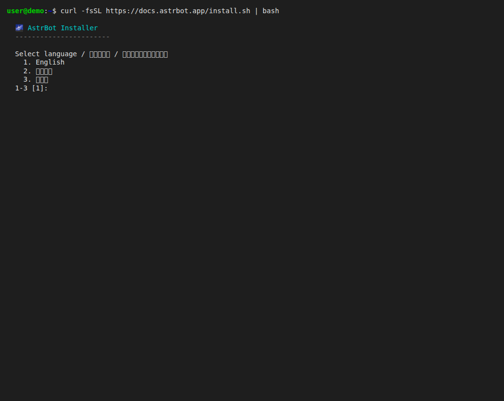
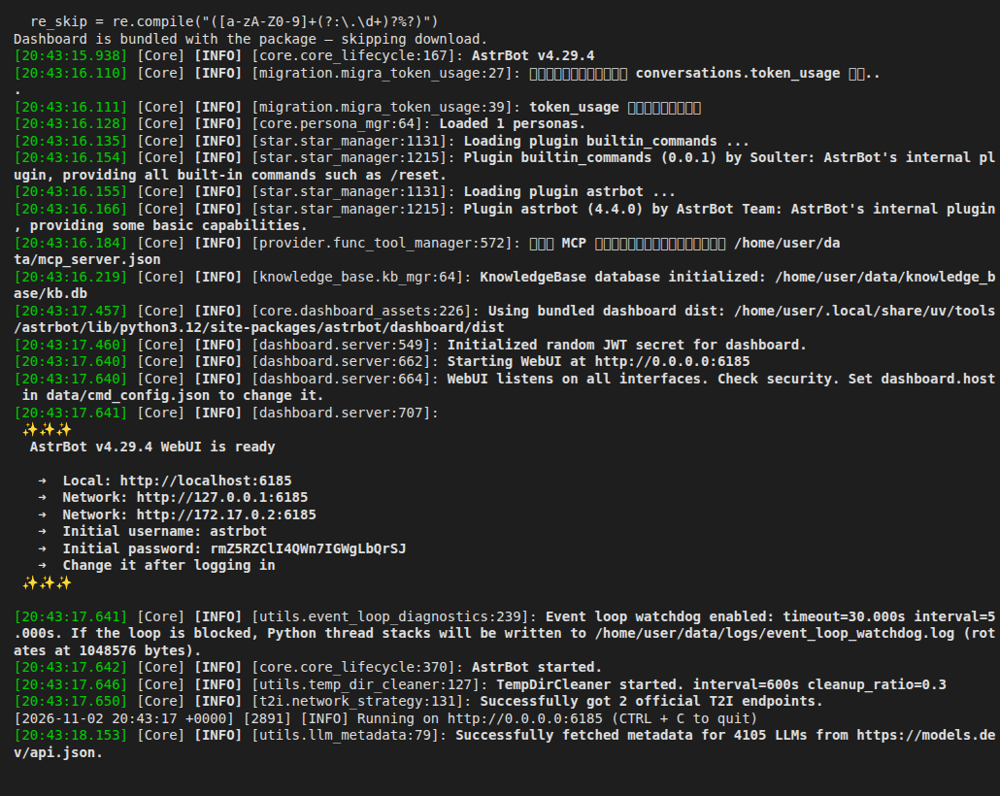
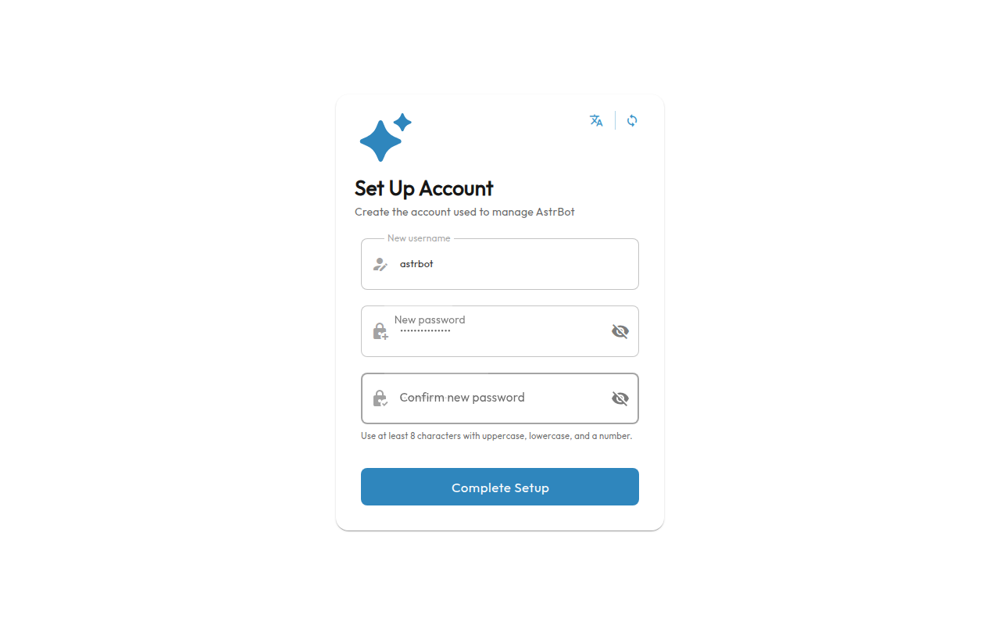
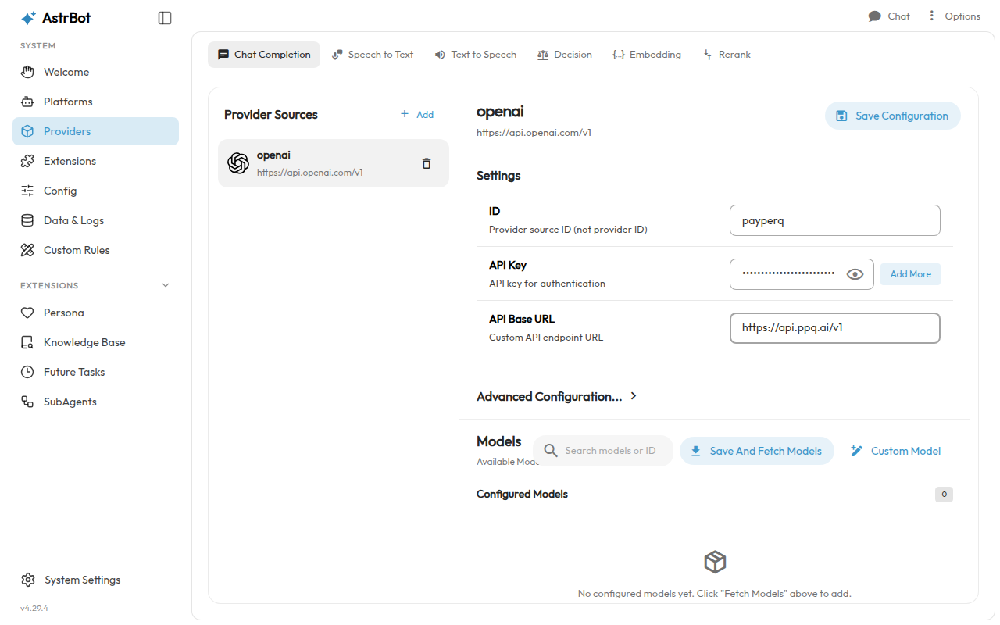
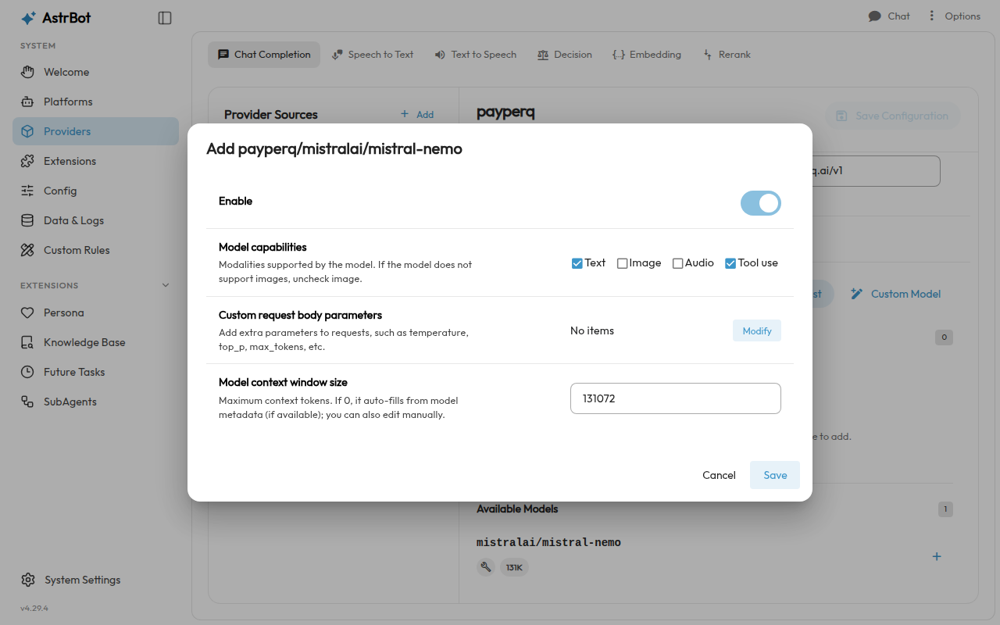
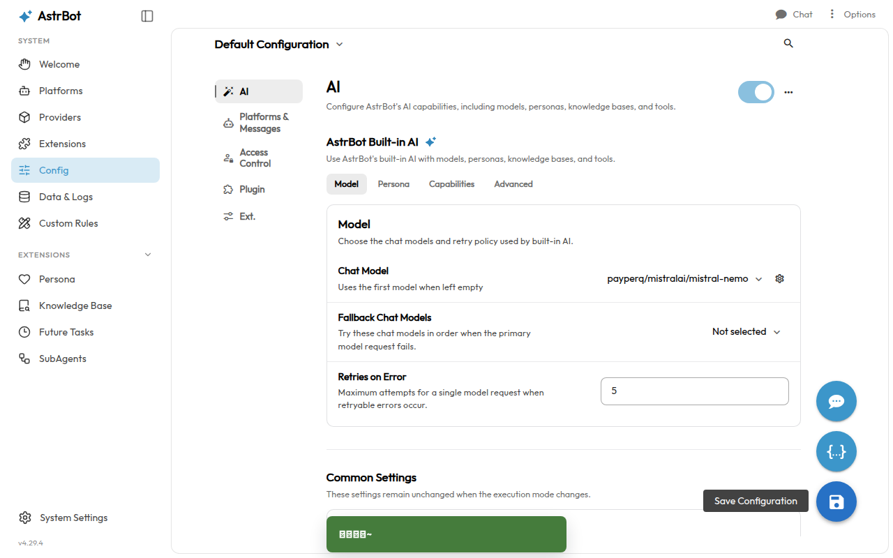
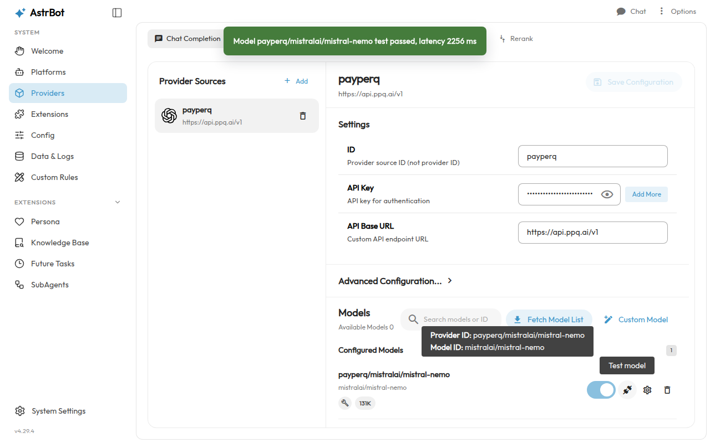
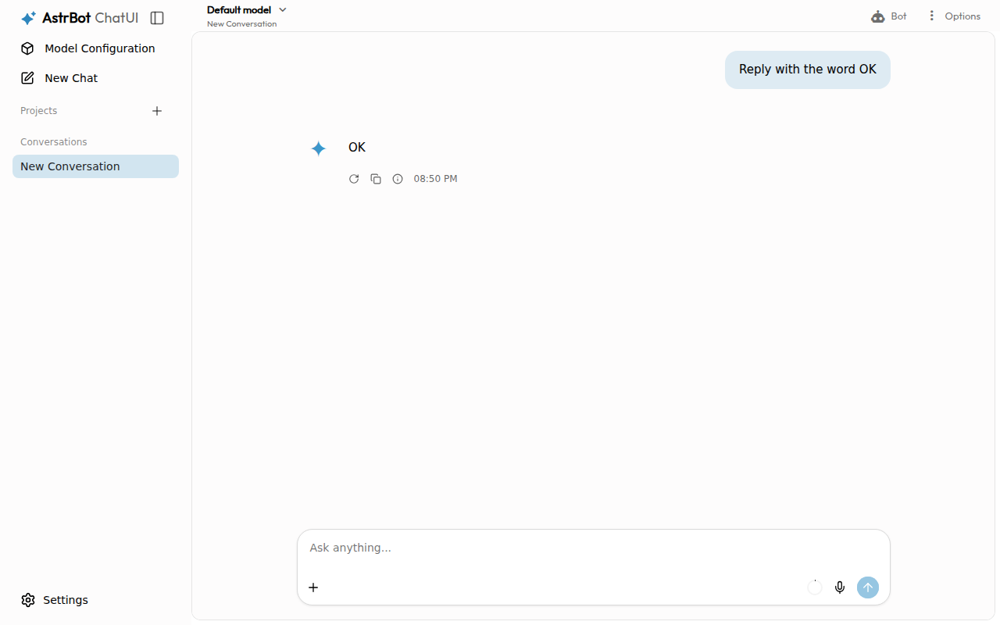

## What is AstrBot?

AstrBot is an open-source agentic chatbot platform from the AstrBotDevs team. You run it yourself, manage it from a web dashboard (the WebUI), and connect it to the model providers and messaging platforms you choose.

AstrBot's docs say it supports the native API formats of OpenAI, Google GenAI and Anthropic, so it can use OpenAI-compatible providers. PayPerQ exposes an OpenAI-compatible API, so you add it as an "OpenAI Compatible" provider and pay per request. Official site: [astrbot.app](https://astrbot.app).

## Step by Step Set Up

### 1. Prerequisites

- A PayPerQ account and API key. Open [ppq.ai/api-docs](https://ppq.ai/api-docs) to copy the key shown there.
- Linux, macOS, WSL or Windows (PowerShell 5.1 or 7+): the platforms AstrBot's install scripts list. The script installs `uv`, AstrBot and Python 3.12 for you.

### 2. Install AstrBot

Run this command in a terminal:

```bash
curl -fsSL https://docs.astrbot.app/install.sh | bash
```

The installer asks two questions:

1. **Select language.** Shows `1. English`, `2. 简体中文`, `3. 日本語` with `[1]` as the default. Press Enter.
   
2. **Select a download source.** Shows `1. Mainland China accelerated download mirrors`, `2. Official sources`, `3. Custom` with `[2]` as the default. Press Enter.

It then downloads Python 3.12 and AstrBot and ends with `[OK]    AstrBot has been installed.`

> **Windows:** AstrBot's docs give a PowerShell installer instead: run `irm https://docs.astrbot.app/install.ps1 | iex` in PowerShell 5.1 or PowerShell 7+.

### 3. Initialize AstrBot

Open a new terminal so the `astrbot` command is on your PATH.

> **Note:** the installer's closing message tells you to reload your shell: `source ~/.bashrc` (Bash), `source ~/.zshrc` (Zsh), `source ~/.config/fish/config.fish` (Fish) or `. $PROFILE` (PowerShell). Running the line for your shell works instead of opening a new terminal.

Run this command to create AstrBot's data folders:

```bash
astrbot init
```

It asks one question:

1. **Install AstrBot to this directory?** Shows your current folder and `[Y/n]`. Press Enter to accept.

It ends with `Done! You can now run 'astrbot run' to start AstrBot`.

### 4. Start AstrBot and log in

Run this command and leave the terminal open:

```bash
astrbot run
```

The log ends with a block like this: `AstrBot v… WebUI is ready`, `Local: http://localhost:6185`, `Initial username: astrbot` and a random `Initial password`.



Open `http://localhost:6185` in your browser, enter the initial username and password from the log, and log in.

> **Note:** the WebUI follows the browser's language. The globe icon at the top of the login page opens a language list that includes English.

The first login opens a **Set Up Account** page:

1. **New username.** Type the username you want to use from now on.
2. **New password** and **Confirm new password.** Type the same password twice: at least 8 characters with an uppercase letter, a lowercase letter and a number.
3. Click **Complete Setup**. The Welcome page opens.
   

### 5. Add PayPerQ as a provider

In the WebUI sidebar, click **Providers**, make sure the **Chat Completion** tab is selected, and click **Add** next to Provider Sources. In the **New model provider** list, choose **OpenAI Compatible**. A provider source opens; fill in these fields:

1. **ID:** `payperq`
2. **API Key:** `<your PayPerQ API key>`
3. **API Base URL:** `https://api.ppq.ai/v1`



> **Note:** AstrBot's docs say that for an OpenAI-compatible service the base URL should end in `/v1`, and to add it if it is missing.

The provider source form is now filled in and ready for **Save And Fetch Models** in the next step. AstrBot stores the key in its own configuration, so you do not need to set an environment variable.

### 6. Pick a model

Click **Save And Fetch Models**. The **Available Models** count shows the models PayPerQ returned.

Type `mistralai/mistral-nemo` in **Search models or ID**, then click the `+` beside it in **Available Models**. An **Add payperq/mistralai/mistral-nemo** dialog opens with **Enable** switched on and **Text** and **Tool use** ticked. Click **Save**.



> **Note:** `mistralai/mistral-nemo` is the example model for this guide. At the time of writing it costs $0.030595 per 1M input tokens and $0.03165 per 1M output tokens. See [api.ppq.ai/v1/models](https://api.ppq.ai/v1/models) for current prices and the full model list; any model ID from that list can be added the same way. The catalog lists plain IDs such as `mistralai/mistral-nemo`; AstrBot shows them as `payperq/mistralai/mistral-nemo`, with your provider ID in front.

The model now appears under **Configured Models** as `payperq/mistralai/mistral-nemo`.

Next, tell AstrBot to use it for chat:

1. In the sidebar, click **Config** and keep **Default Configuration** selected at the top.
2. Under **AI**, on the **Model** tab, open the **Chat Model** dropdown (it shows **Not selected**) and choose `payperq/mistralai/mistral-nemo`.
3. Click the round **Save Configuration** button at the bottom right of the page. A green confirmation appears.
   

### 7. Check the provider and model

Go back to **Providers**, select the `payperq` source, and click the plug icon (**Test model**) beside `payperq/mistralai/mistral-nemo` under **Configured Models**.

A green message appears: `Model payperq/mistralai/mistral-nemo test passed, latency … ms`.



### 8. Send a test prompt

Click **Chat** at the top right of the WebUI to open ChatUI. Type this prompt in the **Ask anything...** box and press Enter:

```text
Reply with the word OK
```

The model answers `OK`.



The setup is complete: AstrBot now answers through PayPerQ. Check what each request cost at [ppq.ai/account-activity](https://ppq.ai/account-activity). To switch models, add another model from the PayPerQ list as in step 6 and select it as the **Chat Model**.

### Troubleshooting

**`astrbot: command not found` right after the installer finishes.** What happened: the terminal you installed from does not have the folder that holds `astrbot` on its PATH, and `source` of your shell file did not change that. Likely cause: the shell profile was not updated by the installer. Fix: run `~/.local/bin/uv tool update-shell`, then run `source ~/.bashrc` (or open a new terminal) and run `astrbot init` again.

## Problems?

Please contact us through the customer communication chatbot in the bottom right of the PayPerQ site, in our [Telegram channel](https://t.me/+ZjJDTazIrV0zNDFh) or on [Discord](https://discord.gg/BmMntEShYg).

This guide is open source. If a step no longer works, open [the guide on GitHub](https://github.com/PayPerQ/ppq-integration-guides/blob/main/guides/using-astrbot-with-payperq.md) and use the pencil icon to propose a fix, or [open an issue](https://github.com/PayPerQ/ppq-integration-guides/issues); changes go live after a PayPerQ maintainer reviews them.
