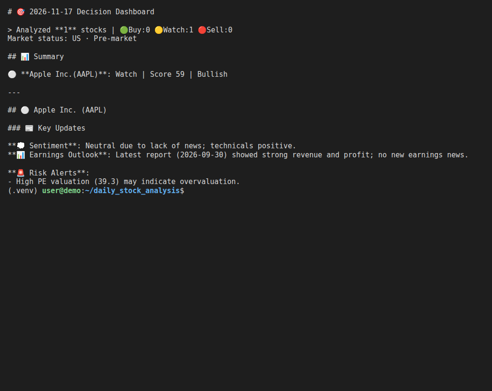

## What is Daily Stock Analysis?

Daily Stock Analysis (DSA) is an open-source, LLM-driven stock analysis system. It covers A-shares, Hong Kong and US stocks, combines quotes, news, technicals and fundamentals, and produces a daily decision dashboard for each stock on your watchlist. The project lives at [github.com/ZhuLinsen/daily_stock_analysis](https://github.com/ZhuLinsen/daily_stock_analysis) and its site is [dsa.zhulinsen.tech](https://dsa.zhulinsen.tech).

DSA reaches its models through LiteLLM and accepts any OpenAI-compatible platform, which is how it connects to PayPerQ. This guide runs it locally from a clone of the repository and analyzes one stock with a PayPerQ model.

## Step by Step Set Up

### 1. Prerequisites

- A PayPerQ account and API key: copy the key from [ppq.ai/api-docs](https://ppq.ai/api-docs).
- Python 3.10 or newer (the project's docs recommend "Python 3.10+").
- Git.

> **Note:** the project's site lists Linux, macOS and Windows as supported operating systems.

### 2. Download Daily Stock Analysis

Run this command to clone the repository and enter it:

```bash
git clone https://github.com/ZhuLinsen/daily_stock_analysis.git && cd daily_stock_analysis
```

Git downloads the project and your terminal is now in the `daily_stock_analysis` folder.

### 3. Install the dependencies

Run this command to create a virtual environment:

```bash
python3 -m venv .venv
```

Run this command to activate it:

```bash
source .venv/bin/activate
```

Your prompt now starts with `(.venv)`. Run this command to install the requirements (it takes a couple of minutes):

```bash
pip install -r requirements.txt
```

It ends without an error after listing the installed packages.

> **Windows:** the project's docs install the requirements from PowerShell with these commands, setting UTF-8 first: `$env:PYTHONUTF8='1'`, `$env:PYTHONIOENCODING='utf-8'`, then `python -m pip install -r requirements.txt`.

### 4. Create the configuration file

Run this command to copy the example configuration to `.env`:

```bash
cp .env.example .env
```

A file named `.env` now exists in the project folder.

### 5. Add PayPerQ as the provider

Edit the file `.env` in the project folder (use any text editor) and add these three lines at the end:

```env
OPENAI_API_KEY=<your PayPerQ API key>
OPENAI_BASE_URL=https://api.ppq.ai/v1
LITELLM_MODEL=openai/inclusionai/ling-3.0-flash
```

Save the file. `OPENAI_API_KEY` and `OPENAI_BASE_URL` are DSA's settings for an OpenAI-compatible platform, and `LITELLM_MODEL` must start with `openai/` followed by the PayPerQ model ID.

> **Note:** `inclusionai/ling-3.0-flash` costs $0.022155 per 1M input tokens and $0.066465 per 1M output tokens at the time of writing. Current prices are in the catalog at [api.ppq.ai/v1/models](https://api.ppq.ai/v1/models).

> **Note:** the model line is an example. Pick any ID from the [full catalog](https://api.ppq.ai/v1/models) and write it after `openai/`. The catalog is JSON with one entry per model; for `LITELLM_MODEL`, use the entry's `id` field.

> **Note:** DSA's docs state that if you enable `LLM_CHANNELS`, "any standard `DEEPSEEK_API_KEY` or `OPENAI_API_KEY` declared independently will be completely ignored". Do not set `LLM_CHANNELS` while you use the three lines above.

### 6. Check the connection

Run this command to send DSA's built-in LLM test:

```bash
python scripts/check_env.py --llm
```

The test runs a sample analysis and takes around half a minute. The output ends with `✓ API 调用成功` followed by `--- 分析结果 ---` and the sample result. The output is in Chinese by default.

### 7. Send a test prompt

Run this command to analyze one stock through DSA's normal analysis flow, without sending notifications and without the market review:

```bash
python main.py --stocks AAPL --no-notify --no-market-review
```

DSA downloads the quotes, calls your PayPerQ model and takes about a minute. The log ends with `成功: 1, 失败: 0` and a line with the stock, advice and score, for example `Apple Inc.(AAPL): 持有观察 | 评分 59 | 看多`. The report is saved as a Markdown file in the `reports` folder.

> **Tip:** reports are written in Chinese by default. Add `REPORT_LANGUAGE=en` as a new line in `.env` and run the command again to get an English report.



Your setup is complete: DSA is analyzing stocks with a PayPerQ model. Check what each run cost at [ppq.ai/account-activity](https://ppq.ai/account-activity). To use another model, change the `LITELLM_MODEL` line in `.env`.

### Troubleshooting

**Error 400, 401 or "Invalid API Key" when running a command.** What happened: PayPerQ or DSA rejected the request. Likely cause (from DSA's troubleshooting table): the key was copied incompletely or has spaces around it, the base URL does not end with `/v1`, the model name lacks the `openai/` prefix, or the account has no credit. Fix: re-copy the key from [ppq.ai/api-docs](https://ppq.ai/api-docs), compare the three lines in step 5 character by character, and check your balance on PayPerQ. Also check that `.env` has no `LLM_CHANNELS` line, which makes DSA ignore `OPENAI_API_KEY`.

**The interface says the primary model is not configured.** What happened: DSA does not know which model to use. Likely cause: the `LITELLM_MODEL` line is missing or misspelled. Fix: add `LITELLM_MODEL=openai/<model ID>` to `.env`, as in step 5.

**The log shows "搜索服务不可用，跳过情报搜索" (news search unavailable) or a warning that all chip-distribution sources failed.** What happened: no news-search provider is configured, and one data source returned nothing. The analysis still finishes. Fix: DSA's docs recommend configuring at least one news search provider for better sentiment and catalyst coverage; see its [search configuration](https://github.com/ZhuLinsen/daily_stock_analysis/blob/main/docs/full-guide_EN.md#search-service-configuration).

## Problems?

Please contact us through the customer communication chatbot in the bottom right of the PayPerQ site, in our [Telegram channel](https://t.me/+ZjJDTazIrV0zNDFh) or on [Discord](https://discord.gg/BmMntEShYg).

This guide is open source. If a step no longer works, open [the guide on GitHub](https://github.com/PayPerQ/ppq-integration-guides/blob/main/guides/using-daily-stock-analysis-with-payperq.md) and use the pencil icon to propose a fix, or [open an issue](https://github.com/PayPerQ/ppq-integration-guides/issues); changes go live after a PayPerQ maintainer reviews them.
