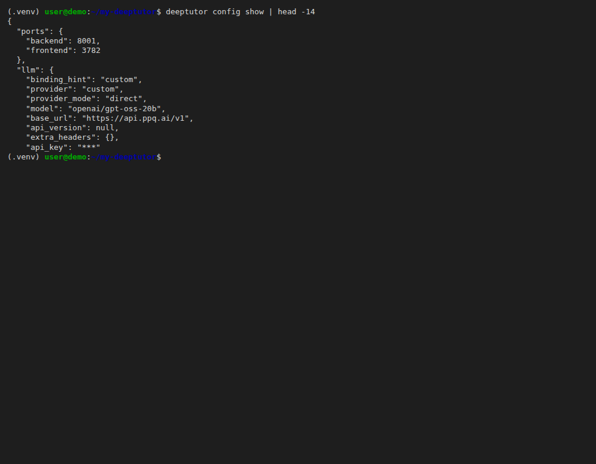
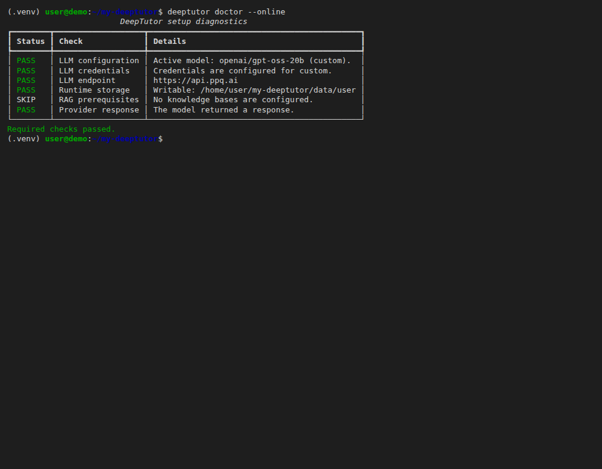
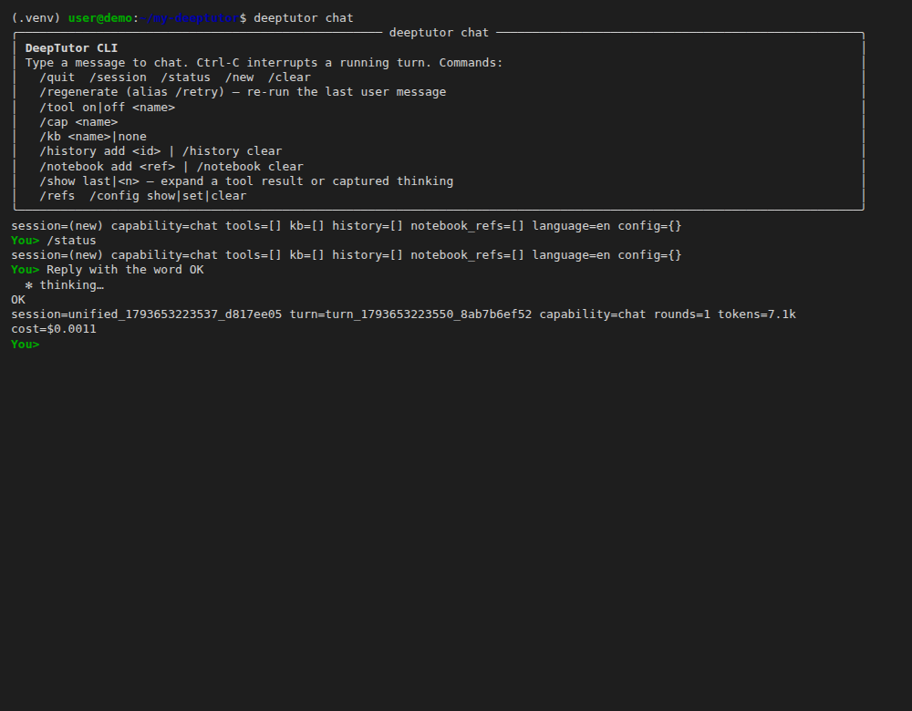

## What is DeepTutor?

DeepTutor is an open-source, agent-native personalized tutoring system from the Data Intelligence Lab at the University of Hong Kong (HKUDS). It runs as a web app and as a command-line tool with an interactive chat, and it can use knowledge bases, notebooks and other learning tools alongside the chat.

DeepTutor accepts any OpenAI-compatible endpoint as a "Custom" provider. That is how you connect it to PayPerQ: you give it the PayPerQ base URL, your API key and a model ID in its setup wizard.

## Step by Step Set Up

### 1. Prerequisites

- A PayPerQ account and API key. Open [ppq.ai/api-docs](https://ppq.ai/api-docs) to copy your key; the page also shows the base URL, `https://api.ppq.ai`.
- Python 3.11 to 3.14, which DeepTutor's install docs require.

### 2. Create a folder and a virtual environment

Run these commands in a terminal, one at a time. First create a working folder for DeepTutor and enter it:

```bash
mkdir -p my-deeptutor && cd my-deeptutor
```

Create a virtual environment:

```bash
python3 -m venv .venv
```

Activate it:

```bash
source .venv/bin/activate
```

Your prompt now starts with `(.venv)`.

> **Windows:** DeepTutor's docs give this PowerShell command for the virtual environment: `py -3.11 -m venv .venv-cli ; .\.venv-cli\Scripts\Activate.ps1`. Use it in place of the two commands above.

> **Note:** DeepTutor stores its settings in a `data/` folder under the folder you start it from, so run every later `deeptutor` command from `my-deeptutor`, with the environment active.

### 3. Install DeepTutor

Run a command to install the full package (web app and command-line tool):

```bash
python -m pip install -U "deeptutor[full]"
```

Expect a long list of installed packages ending without an error.

### 4. Add PayPerQ with the setup wizard

Run a command to start DeepTutor's setup wizard:

```bash
deeptutor init
```

Answer the prompts in order:

1. **Backend port [8001]:** press Enter.
2. **Frontend port [3782]:** press Enter.
3. **Pick an LLM provider:** type **c** (Custom / Other) and press Enter.
4. **Binding [openai]:** type **custom** and press Enter.
5. **Edit Base URL? [Y/n]:** press Enter to accept.
6. **New Base URL:** type **https://api.ppq.ai/v1** and press Enter.
7. **API key (input hidden, Enter to skip):** paste `<your PayPerQ API key>` and press Enter. Nothing is shown while you paste. DeepTutor then fetches the model list from PayPerQ and prints `Found ... model(s).`
8. **Pick a model:** type **c** (Custom model name) and press Enter.
9. **Custom model name:** type **openai/gpt-oss-20b** and press Enter.
10. **Test connection now? [Y/n]:** press Enter. The wizard sends one request to PayPerQ.
11. **Embedding (RAG / Knowledge Base):** type **s** (Skip / configure later) and press Enter.
12. **Web search:** type **s** (Skip / configure later) and press Enter.
13. **Review & save:** the review box lists `LLM  Custom · openai/gpt-oss-20b · https://api.ppq.ai/v1  ✓ probed`. Press Enter at **Save these settings? [Y/n]**. The wizard prints `Settings saved`.

> **Note:** `openai/gpt-oss-20b` costs $0.03165 input and $0.13715 output per 1M tokens at the time of writing. See [api.ppq.ai/v1/models](https://api.ppq.ai/v1/models) for current prices.

> **Note:** The model list at [api.ppq.ai/v1/models](https://api.ppq.ai/v1/models) has its own format. The `id` field is the model name you type at **Custom model name**, and `pricing` holds the prices. `openai/gpt-oss-20b` is the model used in this guide. To try a different catalog model, pick its `id`; if the connection test fails, run `deeptutor init` again and choose another model.

### 5. Check the saved provider and model

Run a command that shows DeepTutor's resolved configuration with the key hidden:

```bash
deeptutor config show
```

The `llm` block must show `"provider": "custom"`, `"model": "openai/gpt-oss-20b"`, `"base_url": "https://api.ppq.ai/v1"` and `"api_key": "***"`.



Then run a command that also sends one request to the configured model:

```bash
deeptutor doctor --online
```

Every required check shows `PASS`, including `Provider response  The model returned a response.`, and the last line reads `Required checks passed.`



### 6. Send a test prompt

Run a command to open DeepTutor's interactive chat:

```bash
deeptutor chat
```

At the `You>` prompt, type this message and press Enter:

```text
Reply with the word OK
```

The model answers `OK`, followed by a line with the session, token count and cost.



Type `/quit` to leave the chat.

> **Optional:** DeepTutor's docs describe a web app for the same settings: run `deeptutor start` (needs Node.js on your PATH), then open `http://127.0.0.1:3782`.

The setup is complete: DeepTutor now answers through PayPerQ. Check what each request cost on [ppq.ai/account-activity](https://ppq.ai/account-activity). To use another model, run `deeptutor init` again and enter a different model ID from the catalog.

### Troubleshooting

**`error: externally-managed-environment` when running `pip install`.** What happened: the system Python refused a global install. Likely cause: the virtual environment from step 2 is not active. Fix: run `source .venv/bin/activate` in `my-deeptutor` and repeat step 3.

**`HTTP 404 ... No allowed providers are available for the selected model` at "Test connection now?".** What happened: PayPerQ could not route the request for that model ID. Likely cause: that model (for example `google/gemini-2.5-flash-lite`) had no provider available for the request. Fix: answer **n** to "Re-enter API key and retry?", finish and save the wizard, then run `deeptutor init` again and choose another model such as `openai/gpt-oss-20b`.

**`401 Unauthorized` from the provider.** What happened: the key was rejected. Likely cause: the key was mistyped or revoked. Fix: copy the key again from [ppq.ai/api-docs](https://ppq.ai/api-docs) and run `deeptutor init` again and answer **n** at the `Reuse the LLM API key ...? [Y/n]` prompt so you can paste the new key; DeepTutor's docs say re-running the wizard preserves the workspace.

## Problems?

Please contact us through the customer communication chatbot in the bottom right of the PayPerQ site, in our [Telegram channel](https://t.me/+ZjJDTazIrV0zNDFh) or on [Discord](https://discord.gg/BmMntEShYg).

This guide is open source. If a step no longer works, open [the guide on GitHub](https://github.com/PayPerQ/ppq-integration-guides/blob/main/guides/using-deeptutor-with-payperq.md) and use the pencil icon to propose a fix, or [open an issue](https://github.com/PayPerQ/ppq-integration-guides/issues); changes go live after a PayPerQ maintainer reviews them.
