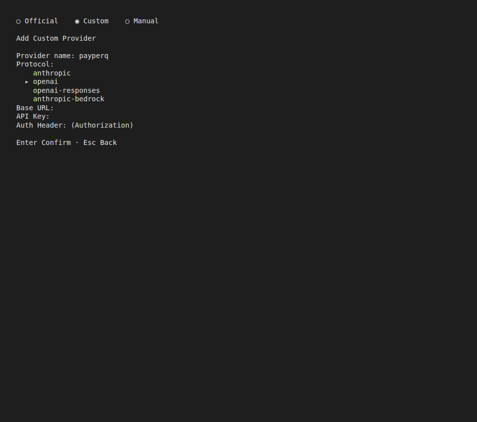
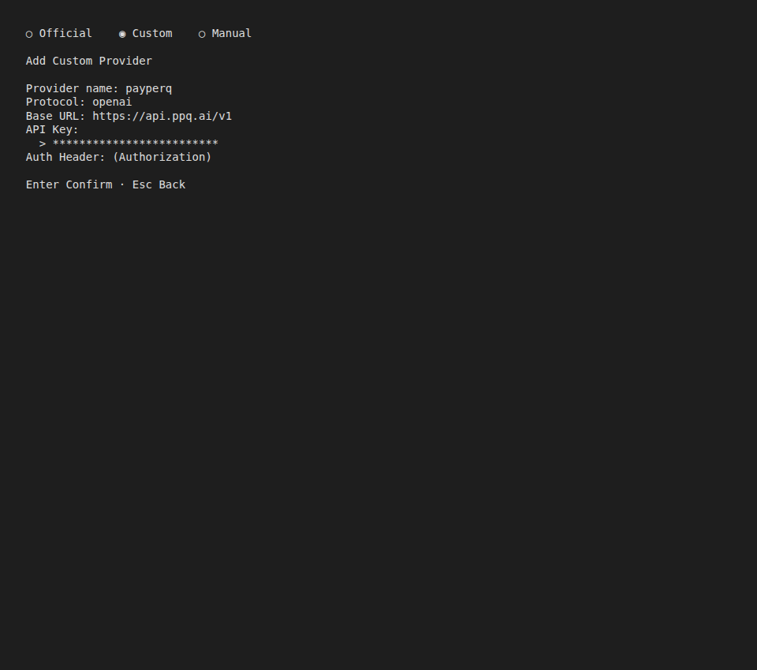
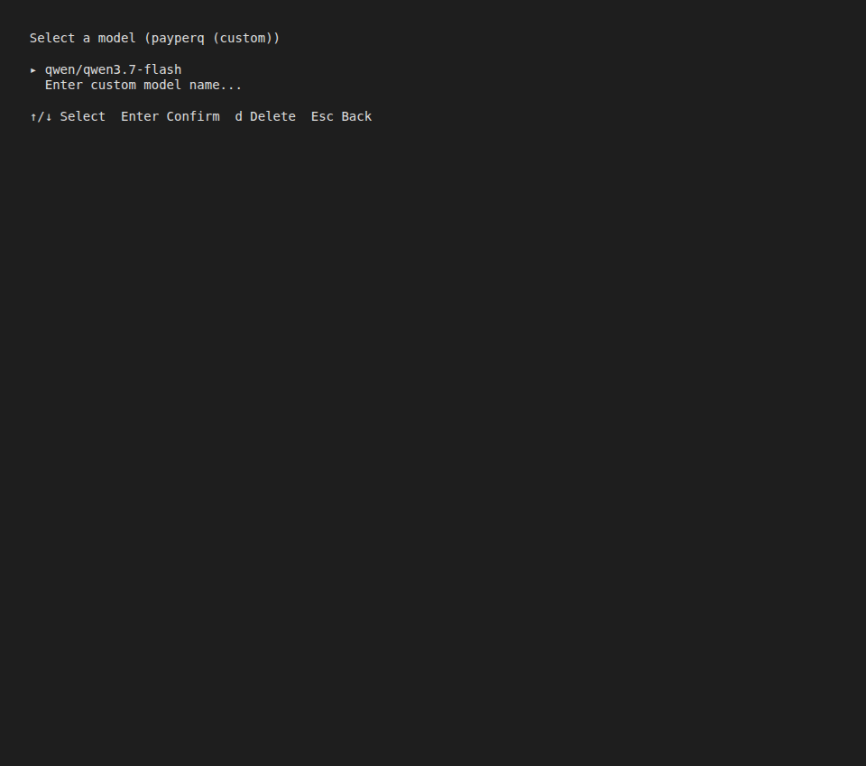
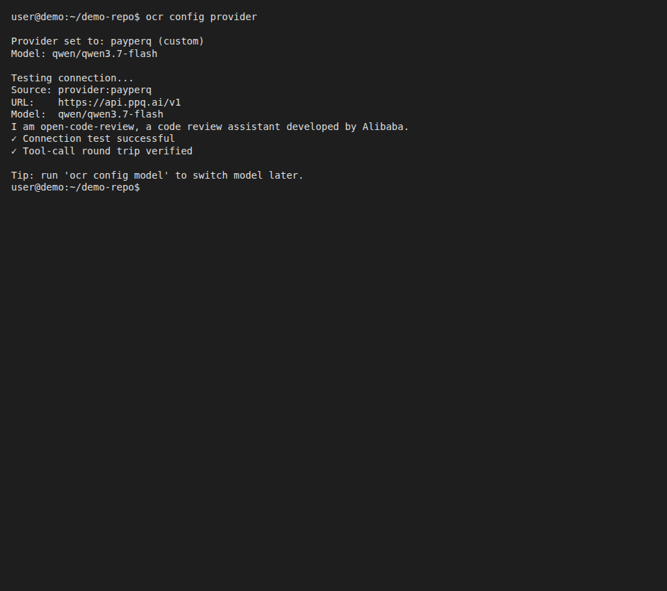
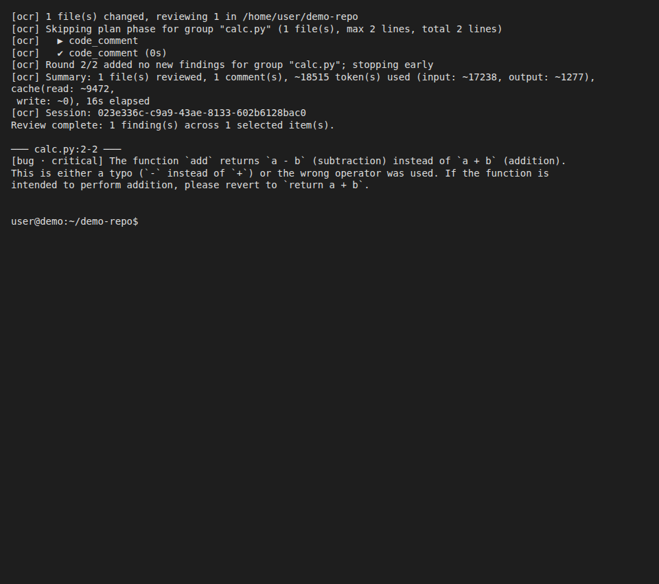

## What is Open Code Review?

[Open Code Review](https://open-codereview.ai) is an AI-powered code review CLI from Alibaba Group, released as open source under the Apache-2.0 license. It reads your Git diffs, sends the changed files to a configurable LLM through an agent with tool-use capabilities, and produces structured review comments with line-level precision.

The `ocr review` command reviews uncommitted changes. You bring the model endpoint; this guide points it at PayPerQ.

## Step by Step Set Up

### 1. Prerequisites

- A PayPerQ account and API key from [ppq.ai/api-docs](https://ppq.ai/api-docs).
- Git 2.41 or newer. The Open Code Review docs list it as a requirement.
- Node.js 18 or newer. The Open Code Review quickstart lists it as a requirement for the npm install.
- Open Code Review's README lists Windows, macOS and Linux as supported platforms.

### 2. Install Open Code Review

Run a command to install the `ocr` CLI globally with npm:

```bash
npm install -g @alibaba-group/open-code-review
```

Then run a command to check it:

```bash
ocr version
```

Expected result: one line starting with `open-code-review` followed by a version number, then the build time and the project URL.

> **Alternative:** the installation docs also list Homebrew (`brew install open-code-review`), and an install script (`curl -fsSL https://open-codereview.ai/install.sh | sh`). For Windows, the docs give a PowerShell installer: `irm https://open-codereview.ai/install.ps1 | iex`.

### 3. Add PayPerQ as a custom provider

Run the interactive setup. It saves the provider, key and model to `~/.opencodereview/config.json`.

```bash
ocr config provider
```

> **Windows:** `~` is your user folder, so this file is `%USERPROFILE%\.opencodereview\config.json`.

Answer the screens in order:

1. **Provider list.** The screen opens on the **Official** tab, with a list of built-in providers. Press **Tab** once to move to the **Custom** tab.
2. **Custom tab.** It shows one entry, `+ Add custom provider`. Press **Enter**.
3. **Provider name.** Type **payperq** and press Enter.
4. **Protocol.** A list shows `anthropic`, `openai`, `openai-responses` and `anthropic-bedrock`. Press **Down** once to highlight **openai**, then Enter.
   
5. **Base URL.** Type **https://api.ppq.ai/v1** and press Enter.
6. **API Key.** Paste `<your PayPerQ API key>` and press Enter. The field shows asterisks.
   
7. **Auth Header.** Leave it empty (the default is `Authorization`) and press Enter.
8. **Select a model.** The list has one entry, `Enter custom model name...`. Press Enter, type **qwen/qwen3.7-flash**, and press Enter again. The model now appears in the list above the custom entry: press **Up** to highlight it, then press Enter.
   
9. **Enter API Key (payperq).** It shows a masked field and says the saved key is kept unless you type a new one. Press **Enter** to keep it.

> **Note:** `qwen/qwen3.7-flash` costs $0.03165 per 1M input tokens and $0.13715 per 1M output tokens at the time of writing. See [api.ppq.ai/v1/models](https://api.ppq.ai/v1/models) for current prices. The model name you type is the `id` field of a catalog entry.

> **Note:** Open Code Review drives a review through tool calls, so its FAQ says the model must support native tool calling. In the PayPerQ catalog, those models list `tools` in `supported_parameters`.

Expected result: the setup tests the connection by itself and prints:



The lines to look for are `Provider set to: payperq (custom)`, `Model: qwen/qwen3.7-flash`, `URL:    https://api.ppq.ai/v1`, `✓ Connection test successful` and `✓ Tool-call round trip verified`.

> **Note:** the Open Code Review docs say custom providers need a non-empty `api_key` and have no environment-variable fallback. When several key sources exist, the docs say a static `api_key` always wins; otherwise `api_key_cmd` runs; only if neither is set does Open Code Review fall back to the provider's environment variable.

### 4. Review code with a PayPerQ model

Run a command to create a small Git repository to review:

```bash
mkdir demo-repo && cd demo-repo && git init
```

Run a command to create a file and commit it:

```bash
printf 'def add(a, b):\n    return a + b\n' > calc.py && git add . && git commit -m init
```

Run a command to introduce a bug without committing it:

```bash
printf 'def add(a, b):\n    return a - b\n' > calc.py
```

> **Tip:** any Git repository with uncommitted changes works; `ocr review` reviews staged, unstaged and untracked changes.

Run the review:

```bash
ocr review
```

Expected result: after a few seconds the review finishes with `Review complete: 1 finding(s)` and a comment on `calc.py:2-2` that flags `return a - b` instead of `a + b`.



Your setup is complete. Check the cost of each review on your [PayPerQ account activity page](https://ppq.ai/account-activity). To use another model, run `ocr config model`.

### Troubleshooting

**`npm install -g` fails with a permissions error (`EACCES`).** What happened: npm could not write to its global folder as your user. Likely cause: Node.js installed from a system package, with a global folder owned by root. Fix: run the same command with `sudo`.

**`no valid LLM endpoint configured`.** What happened: no provider, URL, key and model are saved. Likely cause: the provider setup was never completed. Fix: run `ocr config provider` again (the Open Code Review FAQ describes this error).

**A 401 or 403 after the connection test.** What happened: the endpoint rejected the key. Likely cause: the Open Code Review quickstart says it means "the token is wrong or expired". Another possible cause is a conflicting key source: a static `api_key` always wins over `api_key_cmd` and over an environment variable. Fix: run `ocr config provider`, pick the `payperq` entry and paste the key from ppq.ai/api-docs again, and check that no `api_key_cmd` is set elsewhere.

**`No tool calls parsed` or `Max tool requests reached`, with zero comments.** What happened: the model did not make native tool calls. Likely cause: the FAQ says the model must support native tool calling. Fix: run `ocr config model` and choose a model whose catalog entry lists `tools`.

## Problems?

Please contact us through the customer communication chatbot in the bottom right of the PayPerQ site, in our [Telegram channel](https://t.me/+ZjJDTazIrV0zNDFh) or on [Discord](https://discord.gg/BmMntEShYg).

This guide is open source. If a step no longer works, open [the guide on GitHub](https://github.com/PayPerQ/ppq-integration-guides/blob/main/guides/using-open-code-review-with-payperq.md) and use the pencil icon to propose a fix, or [open an issue](https://github.com/PayPerQ/ppq-integration-guides/issues); changes go live after a PayPerQ maintainer reviews them.
