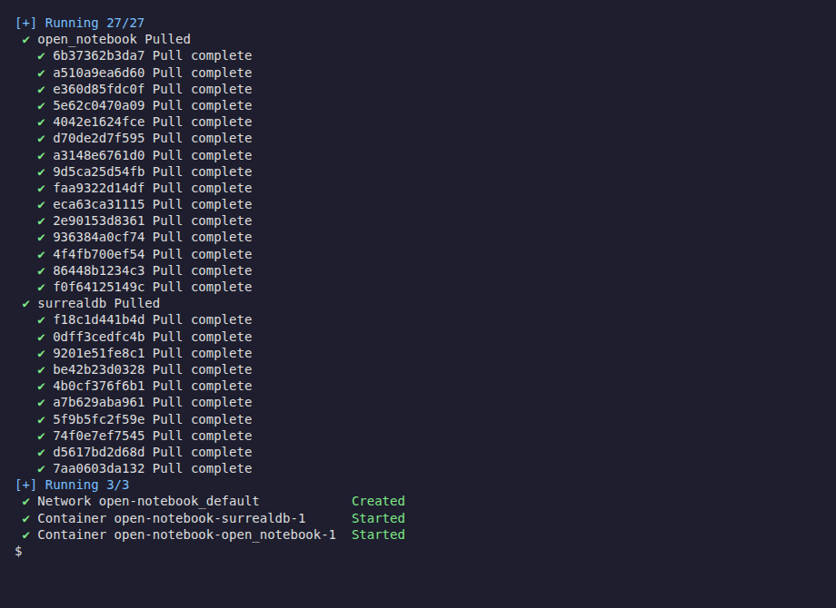
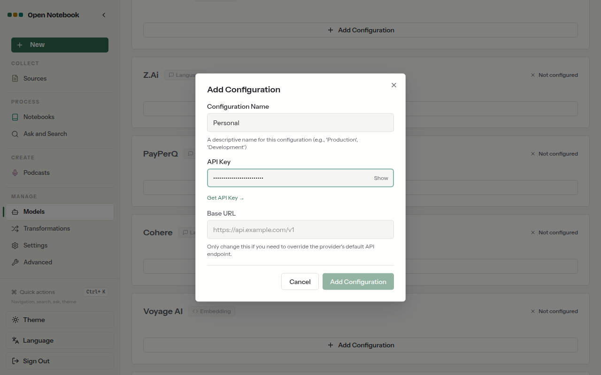
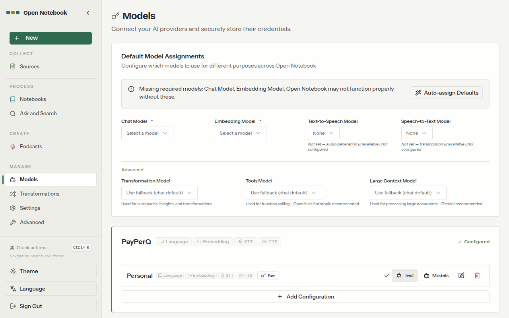
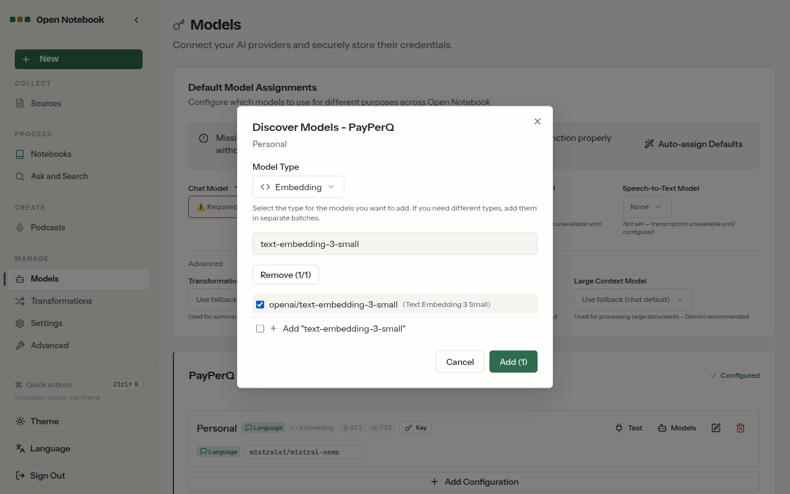
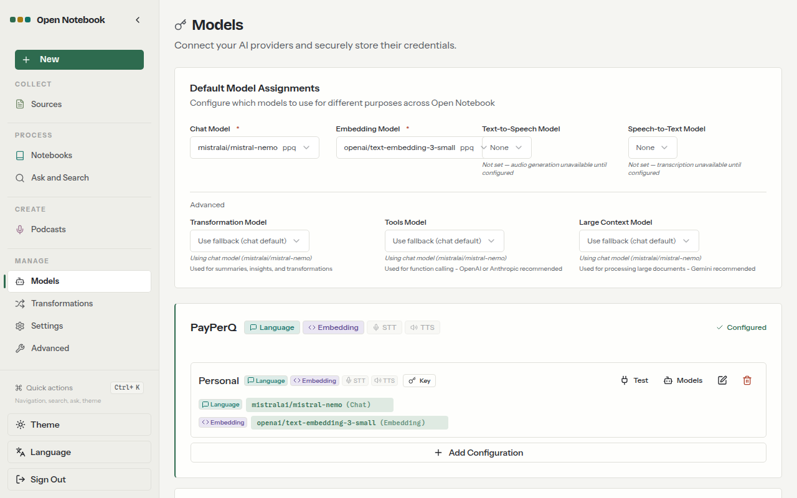
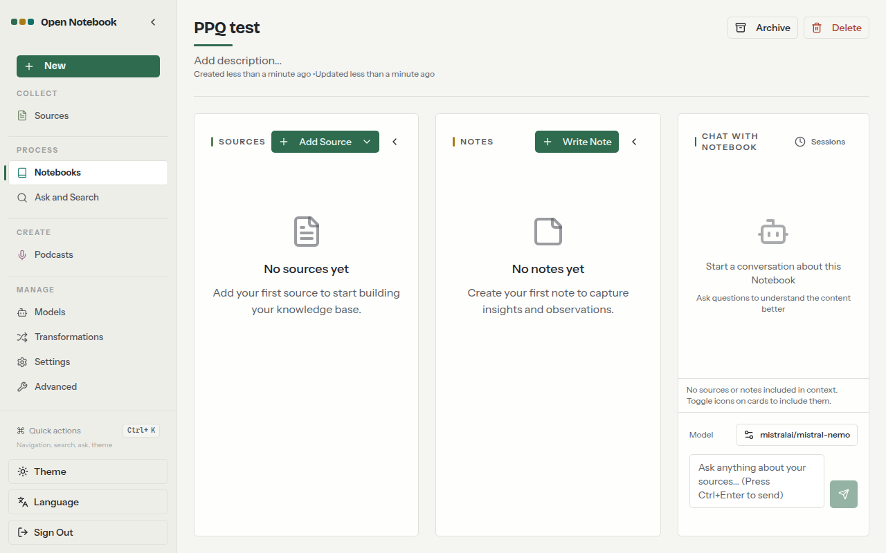
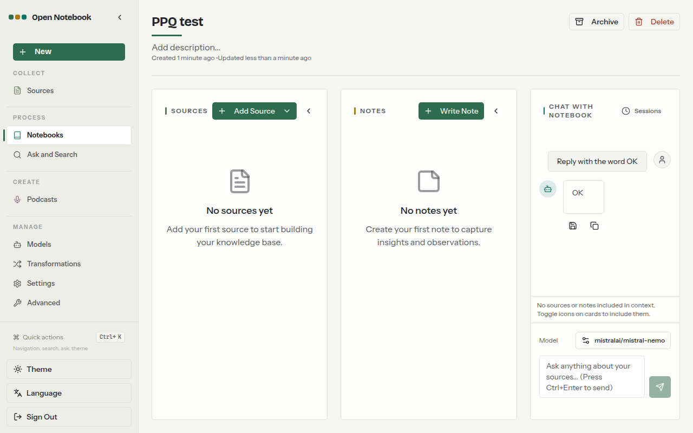

## What is Open Notebook?

[Open Notebook](https://www.open-notebook.ai) is an open source, privacy-focused alternative to Google's Notebook LM. You run it yourself with Docker, collect sources (PDFs, web pages, text, audio and video) in notebooks, and chat with them, search them and generate podcasts.

Open Notebook does not ship its own models. You connect providers under **Manage → Models** and choose a default model for each job. PayPerQ is one of its built-in providers, so you add your PayPerQ API key there and pick models from PayPerQ's catalog.

## Step by Step Set Up

### 1. Prerequisites

- A PayPerQ account and API key, from [ppq.ai/api-docs](https://ppq.ai/api-docs).
- Docker with Compose v2, which the Open Notebook docs require: Docker Desktop on macOS and Windows, Docker Engine with the Compose plugin on Linux. Check with the command below; it prints a Compose version.

```bash
docker compose version
```

### 2. Download the Open Notebook compose file

Run these three commands in order. They create a folder, enter it and download the official `docker-compose.yml`.

```bash
mkdir open-notebook
```

```bash
cd open-notebook
```

```bash
curl -o docker-compose.yml https://raw.githubusercontent.com/lfnovo/open-notebook/main/docker-compose.yml
```

`docker-compose.yml` now exists in the folder.

> **Windows:** in PowerShell, type `curl.exe` instead of `curl`. You can also open the [file on GitHub](https://github.com/lfnovo/open-notebook/blob/main/docker-compose.yml) and save it as `docker-compose.yml`.

### 3. Set your encryption key

Open Notebook encrypts the API keys you store with a secret you choose. It must be set before you can save a provider key.

1. **Generate a secret.** Run this command and copy the 64-character value it prints.

   ```bash
   openssl rand -hex 32
   ```

2. **Edit `docker-compose.yml`.** In the `open_notebook` service, find this line:

   ```yaml
         - OPEN_NOTEBOOK_ENCRYPTION_KEY=change-me-to-a-secret-string
   ```

   Replace `change-me-to-a-secret-string` with the value you generated, then save the file. Keep this value: it is needed to read the stored keys later.

> **Windows:** the Open Notebook docs print a suitable value in PowerShell with `[guid]::NewGuid().ToString("N") + [guid]::NewGuid().ToString("N")`.

> **Note:** by default the web UI (port 8502) and API (port 5055) are published on all network interfaces and there is no password. If other devices can reach your machine, change the two port lines of the `open_notebook` service to `"127.0.0.1:8502:8502"` and `"127.0.0.1:5055:5055"`, or add `- OPEN_NOTEBOOK_PASSWORD=your-password` to its `environment:` block, before starting.

### 4. Start Open Notebook

Run this command in the `open-notebook` folder:

```bash
docker compose up -d
```

Docker pulls the images and starts two containers, `surrealdb` and `open_notebook`. The last lines show both as started.



Wait about 30 seconds, then open http://localhost:8502 in your browser. The Open Notebook page loads.

### 5. Add PayPerQ as a provider

In the left sidebar, under **Manage**, click **Models**. Then:

1. **Find the PayPerQ card.** Scroll down the provider list to **PayPerQ** (it shows Language, Embedding, STT and TTS tags and "Not configured") and click its **Add Configuration** button.
2. **Configuration Name.** Type `Personal` (any label works).
3. **API Key.** Paste `<your PayPerQ API key>`. The field is masked.
4. **Base URL.** Leave it empty.
   
5. **Save.** Click **Add Configuration** in the form. The PayPerQ card moves to the top of the list and shows "Configured".
6. **Test the connection.** On the new `Personal` configuration, click **Test**. A green check appears next to the button.
   

> **Note:** the Test button sends a request to PayPerQ, so it uses a little of your balance.

### 6. Pick the models

Open Notebook needs one **Language** model (chat) and one **Embedding** model (search and Ask). This guide uses `mistralai/mistral-nemo` for chat and `openai/text-embedding-3-small` for embeddings.

> **Note:** `mistralai/mistral-nemo` costs $0.030595 per 1M input tokens and $0.03165 per 1M output tokens at the time of writing, and `openai/text-embedding-3-small` costs $0.022 per 1M input tokens. Both are examples; see [https://api.ppq.ai/v1/models](https://api.ppq.ai/v1/models) for the full catalog and current prices (embedding models are listed at [https://api.ppq.ai/v1/models?type=embedding](https://api.ppq.ai/v1/models?type=embedding)). Open Notebook uses the catalog's `id` as the model name.

1. **Open the model list.** On the `Personal` configuration, click **Models**. The **Discover Models - PayPerQ** dialog opens.
2. **Model Type.** Leave **Language** selected.
3. **Search.** Type `mistral-nemo` in the search box.
4. **Tick the model.** Tick `mistralai/mistral-nemo (Mistral Nemo)`, then click **Add (1)**. A "Success" message appears and the model is listed under the configuration.
5. **Open the list again.** Click **Models** on the configuration.
6. **Model Type.** Open the dropdown and choose **Embedding**.
7. **Search.** Type `text-embedding-3-small`.
8. **Tick the model.** Tick `openai/text-embedding-3-small (Text Embedding 3 Small)`, then click **Add (1)**.
   
9. **Assign defaults.** At the top of the page, click **Auto-assign Defaults** in the "Missing required models" notice. **Chat Model** now shows `mistralai/mistral-nemo` and **Embedding Model** shows `openai/text-embedding-3-small`, each tagged `ppq`.
   

### 7. Check the active model

In the left sidebar click **Notebooks**, click **New Notebook**, type a name such as `PPQ test` and click **Create New Notebook**. Click the notebook to open it. In the **Chat with Notebook** panel at the right, the **Model** button at the bottom must show `mistralai/mistral-nemo`.



### 8. Send a test prompt

In the chat box at the bottom right, type the prompt below and press **Ctrl+Enter** to send it (the box says "Press Ctrl+Enter to send").

```text
Reply with the word OK
```

The answer `OK` appears under your message.



The setup is complete: Open Notebook now chats and embeds through PayPerQ. Check what each request cost at [ppq.ai/account-activity](https://ppq.ai/account-activity). To use another model, add it from the **Models** dialog of your configuration and pick it in the chat's **Model** button or under **Default Model Assignments**.

### Troubleshooting

**The Models page says "Encryption key not configured" and will not store the key.** What happened: `OPEN_NOTEBOOK_ENCRYPTION_KEY` is not set. Likely cause: the placeholder value was not replaced, or the file was not saved before `docker compose up -d`. Fix: set the value as in step 3, then run `docker compose up -d` again.

**Test shows a red cross, or "Invalid API key".** What happened: Open Notebook could not reach PayPerQ with the key. Likely cause: the key was pasted incompletely. Fix: click the pencil icon on the configuration, paste the key again from [ppq.ai/api-docs](https://ppq.ai/api-docs), leave **Base URL** empty and click **Test** again.

**Pressing Enter in the chat box does not send the prompt.** What happened: the box sends on Ctrl+Enter, as its placeholder says. Fix: press **Ctrl+Enter** or click the send button.

**The Models page asks for a Chat Model or Embedding Model ("Required - Select a model").** What happened: no default is assigned. Likely cause: the models were added but not assigned. Fix: click **Auto-assign Defaults**, or pick each model from its dropdown under **Default Model Assignments**.

## Problems?

Please contact us through the customer communication chatbot in the bottom right of the PayPerQ site, in our [Telegram channel](https://t.me/+ZjJDTazIrV0zNDFh) or on [Discord](https://discord.gg/BmMntEShYg).

This guide is open source. If a step no longer works, open [the guide on GitHub](https://github.com/PayPerQ/ppq-integration-guides/blob/main/guides/using-open-notebook-with-payperq.md) and use the pencil icon to propose a fix, or [open an issue](https://github.com/PayPerQ/ppq-integration-guides/issues); changes go live after a PayPerQ maintainer reviews them.
