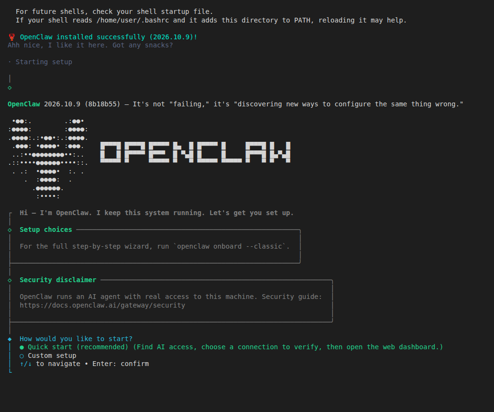
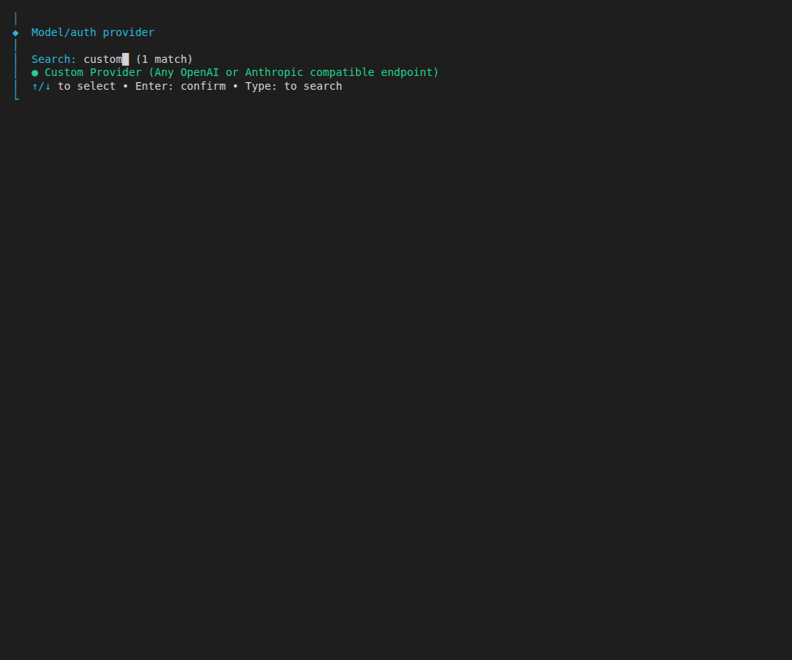
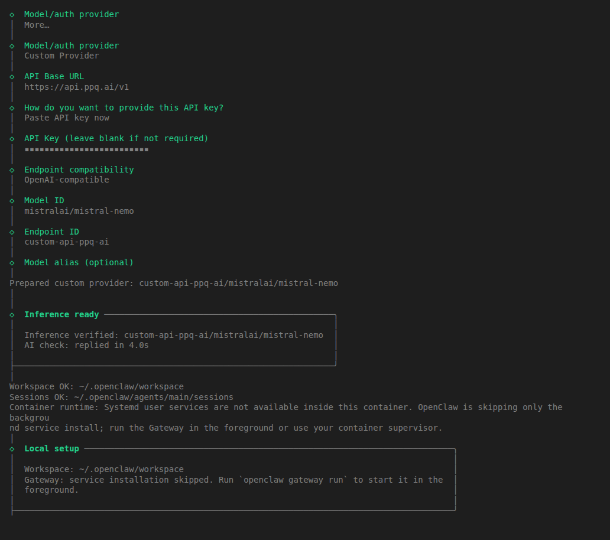
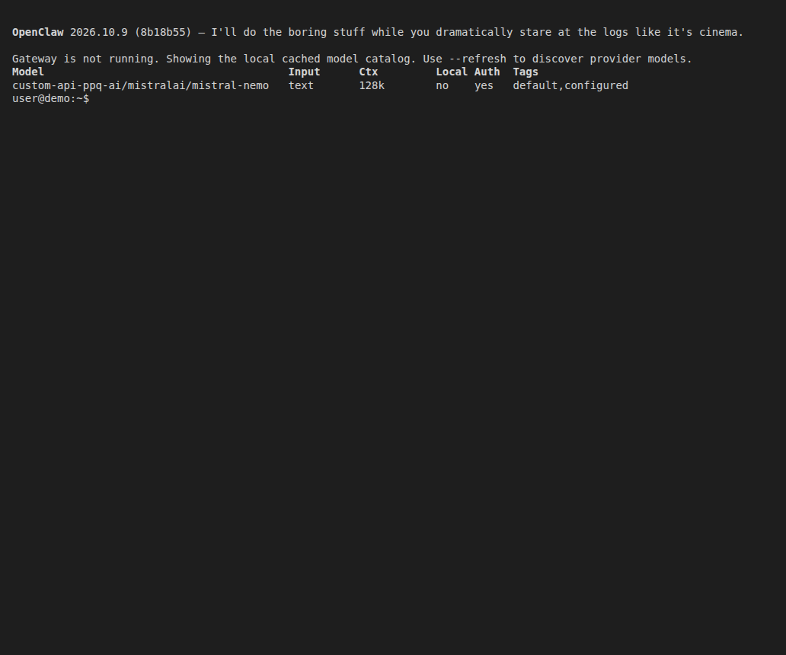
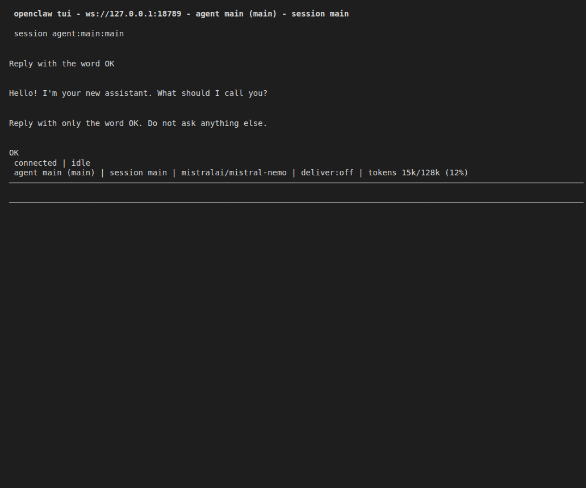

## What is OpenClaw?

OpenClaw is an app that can connect to many of your personal apps (whatsapp, telegram, email, slack, many more), and serve as an assistant or agent for many activities and automated tasks.

## Step by Step Configuration

This guide uses OpenClaw's own setup wizard (`openclaw onboard`), which the OpenClaw docs describe as "the recommended terminal setup path on macOS, Linux, and Windows (native or WSL2)". The wizard has a **Custom Provider** option that accepts any OpenAI-compatible endpoint, so PayPerQ is added there and the key is stored by OpenClaw.

### 1. Download OpenClaw

Install OpenClaw as the [official GitHub repository](https://github.com/openclaw/openclaw) says.

On macOS, Linux or WSL2:

```bash
curl -fsSL https://openclaw.ai/install.sh | bash
```

On Windows, the OpenClaw docs give this PowerShell command:

```powershell
iwr -useb https://openclaw.ai/install.ps1 | iex
```

The installer needs a supported Node.js: the OpenClaw docs list Node.js 24.16.0+ on 24.x, or 26.1.0+. They say the installer "provisions a supported Node.js runtime when needed".
If the installer ends with `PATH missing npm global bin dir`, it prints the exact line to run for the current terminal and tells you to check your shell startup file for future terminals. Until you do that, `openclaw` may not be found.

> **Shell profile:** on macOS the default shell is zsh and the profile is `~/.zshrc`; on most Linux distributions it is bash and `~/.bashrc`; on Windows, PowerShell loads the file named by `$PROFILE`. Open a new terminal after editing it.

When the installer finishes it starts the onboarding wizard:



### 2. Get Your PayPerQ API Key

Navigate to [ppq.ai/api-docs](https://ppq.ai/api-docs) and copy your API key. It starts with `sk-`. You can create more keys at [ppq.ai/api-keys](https://ppq.ai/api-keys).

### 3. Update Your OpenClaw Config File

In the wizard, answer the prompts like this (run `openclaw onboard` to start it again later):

1. **How would you like to start?** Quick start (recommended).
2. **What would you like to create?** One agent.
3. **Model/auth provider:** choose **More…**, type `custom` to search, and pick **Custom Provider (Any OpenAI or Anthropic compatible endpoint)**.



4. **API Base URL:** `https://api.ppq.ai/v1`
5. **How do you want to provide this API key?** Paste API key now, then paste `<your PayPerQ API key>` (the field is masked).
6. **Endpoint compatibility:** OpenAI-compatible (Uses /chat/completions).
7. **Model ID:** `mistralai/mistral-nemo`
8. **Endpoint ID** and **Model alias:** press Enter to accept the defaults (the endpoint ID is `custom-api-ppq-ai`).

> **Note:** `mistralai/mistral-nemo` costs $0.030595 per 1M input tokens and $0.03165 per 1M output tokens at the time of writing. See [api.ppq.ai/v1/models](https://api.ppq.ai/v1/models) for current prices.

The wizard then sends a real request to PayPerQ and prints `Inference verified: custom-api-ppq-ai/mistralai/mistral-nemo` and `AI check: replied in …`:



The wizard writes a `models.providers.custom-api-ppq-ai` entry (base URL, `openai-completions`, the model) to `~/.openclaw/openclaw.json`.

> **Windows:** `~` is your user folder, so this file is `%USERPROFILE%\.openclaw\openclaw.json`.

**Alternative:** the OpenClaw docs describe adding a provider by hand under `models.providers` in that file, with `baseUrl`, `apiKey`, `api: "openai-completions"` and a `models` list. Use the wizard if you can. If you edit the file, merge the entry into your existing config rather than replacing it, and keep the key out of anything you share:

```json
{
  "models": {
    "mode": "merge",
    "providers": {
      "ppq": {
        "baseUrl": "https://api.ppq.ai/v1",
        "apiKey": "YOUR_PAYPERQ_API_KEY",
        "api": "openai-completions",
        "models": [
          { "id": "mistralai/mistral-nemo", "name": "Mistral Nemo", "input": ["text"], "contextWindow": 131072 }
        ]
      }
    }
  }
}
```

This is an example model entry; replace `YOUR_PAYPERQ_API_KEY` with your PayPerQ API key.

### 4. Restart the Gateway

Quick start runs the Gateway in the foreground of the wizard's terminal until you press Ctrl+C; your config stays saved. The OpenClaw docs then say to install it as a background service:

```bash
openclaw gateway install
```

After you change the configuration later, apply it with `openclaw gateway restart`.

## Some Good Models to Try

The Model ID in the wizard can be any ID from the PayPerQ catalog. Example model IDs (check the current list at [api.ppq.ai/v1/models](https://api.ppq.ai/v1/models)); these exist in the catalog and list `tools` support:

- **claude-sonnet-5.5** - Anthropic Sonnet model
- **moonshotai/kimi-k2.6** - Moonshot AI's multimodal coding model
- **mistralai/devstral-2512** - Mistral AI's development model
- **google/gemini-3-flash-preview** - Google's multimodal model
- **z-ai/glm-4.7** - Z-AI's model
- **minimax/minimax-m2.1** - MiniMax's model
- **And many more**

## Get the Most Recent Models

Want to see all available models? You can fetch the most up-to-date list directly from PayPerQ's API:

```bash
curl https://api.ppq.ai/v1/models
```

This endpoint returns a JSON list of all currently available models on PayPerQ.

## Verify Your Setup

List the configured models:

```bash
openclaw models list
```

You must see a row for `custom-api-ppq-ai/mistralai/mistral-nemo` tagged `default,configured`:



With the Gateway running, start the terminal chat with `openclaw`. Its footer shows `mistralai/mistral-nemo`. Send a short message such as `Reply with only the word OK. Do not ask anything else.` and the model answers through PayPerQ:



You can also check that requests are processed in your usage history at [ppq.ai/account-activity](https://ppq.ai/account-activity).

## Try AutoClaw — Smart Model Routing

Don't want to pick a model yourself? [AutoClaw](/blog/using-autoclaw-with-payperq) is our intelligent router that automatically selects the best model for each prompt — saving you money on simple questions while using top-tier models when it matters.

## Troubleshooting

- **`sudo is required for system installs on Linux`:** the installer needs to install Node.js system-wide and stops without sudo. Install sudo or re-run the installer as root.
- **`PATH missing npm global bin dir`, or `openclaw` not found:** run the `export PATH=...` line the installer prints, and add it to your shell startup file for future terminals.

## Problems?

Please contact us through the customer communication chatbot in the bottom right of the PayPerQ site, in our [Telegram channel](https://t.me/+ZjJDTazIrV0zNDFh) or on [Discord](https://discord.gg/BmMntEShYg).

This guide is open source. If a step no longer works, open [the guide on GitHub](https://github.com/PayPerQ/ppq-integration-guides/blob/main/guides/using-openclaw-with-payperq.md) and use the pencil icon to propose a fix, or [open an issue](https://github.com/PayPerQ/ppq-integration-guides/issues); changes go live after a PayPerQ maintainer reviews them.
