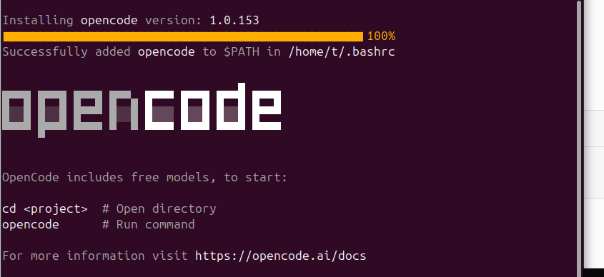
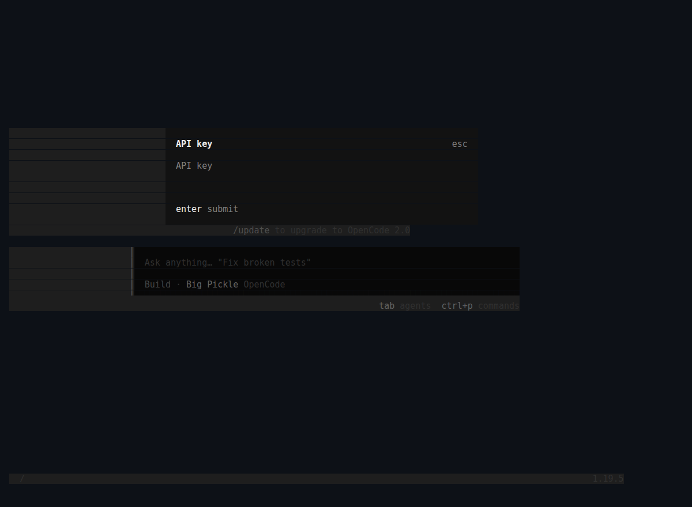
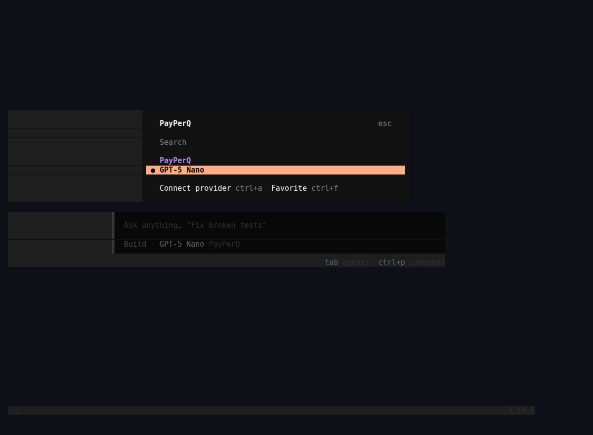
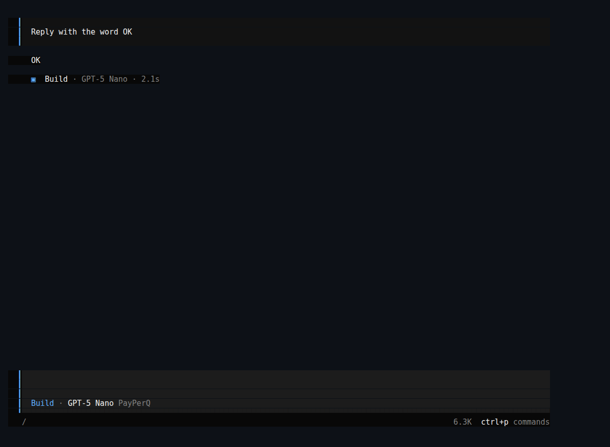
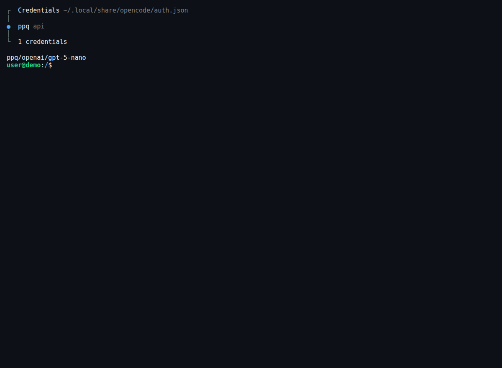

## What is OpenCode?

OpenCode is an open source AI coding agent that helps you write code directly in your terminal, IDE, or desktop application. With OpenCode, you can leverage AI to assist with coding tasks, refactoring, debugging, and more—all through a simple command-line interface or desktop app.

## Why Use PayPerQ with OpenCode?

By connecting OpenCode to PayPerQ's API, you can pick from the models in the PayPerQ catalog (Anthropic, OpenAI, Google, Moonshot and many more) with simple pay-per-use pricing, no subscription required. The full, current list is at [api.ppq.ai/v1/models](https://api.ppq.ai/v1/models).

Prerequisites:

- A PayPerQ account and API key.
- On Windows, the OpenCode docs recommend WSL (see the callout in step 1).

## Step by Step Set Up

### 1. Install OpenCode

Install OpenCode with the official script:

```bash
curl -fsSL https://opencode.ai/install | bash
```

The installer adds `~/.opencode/bin` to your PATH. Open a new terminal afterwards so the `opencode` command is found.

> **Shell profile:** on macOS the default shell is zsh and the profile is `~/.zshrc`; on most Linux distributions it is bash and `~/.bashrc`; on Windows, PowerShell loads the file named by `$PROFILE`. Open a new terminal after editing it.

> **Windows:** the OpenCode docs say: "For the best experience on Windows, we recommend using Windows Subsystem for Linux (WSL)." See [opencode.ai/docs/windows-wsl](https://opencode.ai/docs/windows-wsl/).

**Alternatives** (from the [OpenCode docs](https://opencode.ai/docs/)):

```bash
npm install -g opencode-ai
```

```bash
brew install anomalyco/tap/opencode
```

For more installation options, visit the [OpenCode GitHub repository](https://github.com/anomalyco/opencode).

### 2. Get Your PayPerQ API Key

Navigate to [ppq.ai/api-docs](https://ppq.ai/api-docs) and copy your API key. You can create more keys at [ppq.ai/api-keys](https://ppq.ai/api-keys). You will paste it into OpenCode in step 5.



### 3. Locate Your OpenCode Config Folder

OpenCode's global config file is `~/.config/opencode/opencode.json` ([OpenCode config docs](https://opencode.ai/docs/config/)). Create the folder if it does not exist:

```bash
mkdir -p ~/.config/opencode
```

> **Windows:** `~` is your user folder, so this file is `%USERPROFILE%\.config\opencode\opencode.json`.

### 4. Create the Configuration File

Create `~/.config/opencode/opencode.json` with this content. It declares the PayPerQ provider and one example model. It does not contain your API key: you add that with `/connect` in step 5.

```json
{
  "$schema": "https://opencode.ai/config.json",
  "provider": {
    "ppq": {
      "npm": "@ai-sdk/openai-compatible",
      "name": "PayPerQ",
      "options": {
        "baseURL": "https://api.ppq.ai/v1"
      },
      "models": {
        "openai/gpt-5-nano": {
          "name": "GPT-5 Nano"
        }
      }
    }
  }
}
```

> **Note:** `openai/gpt-5-nano` is an economical example model; its price is $0.05275 per 1M input tokens and $0.422 per 1M output tokens at the time of writing. See [api.ppq.ai/v1/models](https://api.ppq.ai/v1/models) for current prices.

The model list above is an example. The full catalog is at [api.ppq.ai/v1/models](https://api.ppq.ai/v1/models), and its format is different from OpenCode's: in OpenCode's `models` section the key is the catalog entry's `id`, and `name` is any display name you want. Per the OpenCode docs, "Each ID must match the id returned by GET /v1/models".

### 5. Launch OpenCode and Select Your Model

Start OpenCode:

```bash
opencode
```

Then store your key. In the OpenCode prompt, type `/connect`, scroll to **Other**, enter the provider id `ppq` (the id used in this guide's `opencode.json`), and paste your key when asked for **API key**:

```
/connect
```



Per the OpenCode docs, `/connect` stores credentials in `~/.local/share/opencode/auth.json`.

> **Note:** the docs describe `options.apiKey` in the config as "Optionally set the API key, if not using auth". Use one method consistently: this guide uses `/connect`.

After the key is saved, OpenCode shows the PayPerQ model picker. You can open it again any time with `/models`:

```
/models
```



You must see **PayPerQ** with **GPT-5 Nano** under it. Select it; the bar under the prompt then reads `Build · GPT-5 Nano PayPerQ`.

### 6. Verify Your Setup

Send a short test prompt:

```
Reply with the word OK
```



You can also check the setup from a normal terminal:

```bash
opencode providers list
opencode models ppq
```

You should see `ppq api` under the credentials in `~/.local/share/opencode/auth.json`, and `ppq/openai/gpt-5-nano` in the model list.



Requests also show up in your usage history at [ppq.ai/account-activity](https://ppq.ai/account-activity).

## Available Models

You can add model IDs from the [PayPerQ catalog](https://api.ppq.ai/v1/models) to the `models` section of `opencode.json`. For a coding agent, prefer models whose `supported_parameters` include `tools`.

## Get the Most Recent Models

To see the up-to-date list of models directly from PayPerQ's API:

```bash
curl https://api.ppq.ai/v1/models
```

This endpoint returns a JSON list of all currently available models. You can use it to check for new models and to build your own `opencode.json` with the models you want.

### Let AI Update Your Configuration Automatically

You can ask an AI model on PPQ to build the `models` section for you:

1. **Visit the models API endpoint** in your browser: [https://api.ppq.ai/v1/models](https://api.ppq.ai/v1/models)
2. **Copy the entire JSON response** (Ctrl+A or Cmd+A to select all, then copy)
3. **Go to [ppq.ai](https://ppq.ai)** and start a new chat with any AI model
4. **Paste this prompt along with the models data:**

```
I have this list of models from the PPQ API:

[PASTE THE JSON RESPONSE HERE]

Please create an OpenCode configuration file using this EXACT structure. For each model in the API response that I list below, extract ONLY the "id" field and add it to the models section:

{
  "$schema": "https://opencode.ai/config.json",
  "provider": {
    "ppq": {
      "npm": "@ai-sdk/openai-compatible",
      "name": "PayPerQ",
      "options": {
        "baseURL": "https://api.ppq.ai/v1"
      },
      "models": {
        "openai/gpt-5-nano": {
          "name": "openai/gpt-5-nano"
        }
      }
    }
  }
}

CRITICAL: Each model entry must have the model ID as the object key and a "name" property. Do NOT include any other fields from the API response. Do NOT add an apiKey.

The models I want: [LIST THE MODEL IDS YOU WANT]
```

5. **Copy the result** and save it as `~/.config/opencode/opencode.json`, then connect your key with `/connect` as in step 5.

## Tips for Best Results

- **Choose the right model:** pick models whose catalog entry lists `tools` in `supported_parameters`, since OpenCode is a coding agent.
- **Monitor your usage:** check [ppq.ai/account-activity](https://ppq.ai/account-activity) to track API usage and costs.
- **Experiment:** different models excel at different tasks, so try a few to find your favorite.

## Troubleshooting

**HTTP 401 "Invalid API key":** PayPerQ returns this when the key is not found or has been revoked. Copy a current key from [ppq.ai/api-docs](https://ppq.ai/api-docs) or [ppq.ai/api-keys](https://ppq.ai/api-keys) and enter it again with `/connect`.

## Problems?

Please contact us through the customer communication chatbot in the bottom right of the PayPerQ site, in our [Telegram channel](https://t.me/+ZjJDTazIrV0zNDFh) or on [Discord](https://discord.gg/BmMntEShYg).

This guide is open source. If a step no longer works, open [the guide on GitHub](https://github.com/PayPerQ/ppq-integration-guides/blob/main/guides/using-opencode-with-payperq.md) and use the pencil icon to propose a fix, or [open an issue](https://github.com/PayPerQ/ppq-integration-guides/issues); changes go live after a PayPerQ maintainer reviews them.
