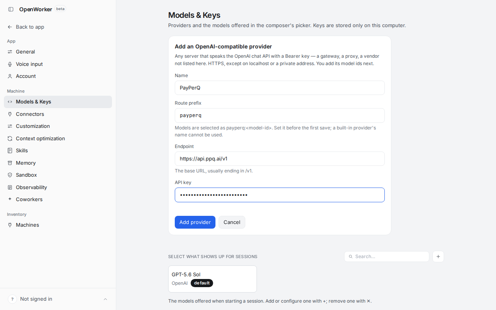
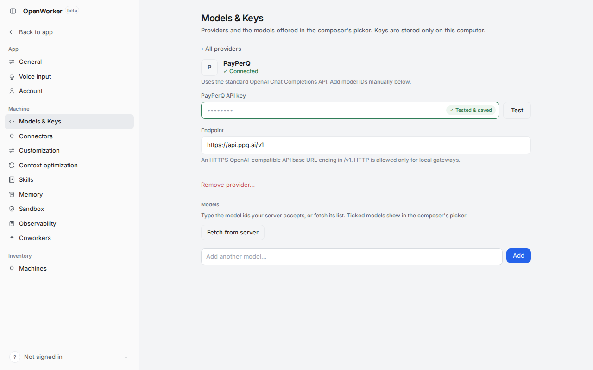
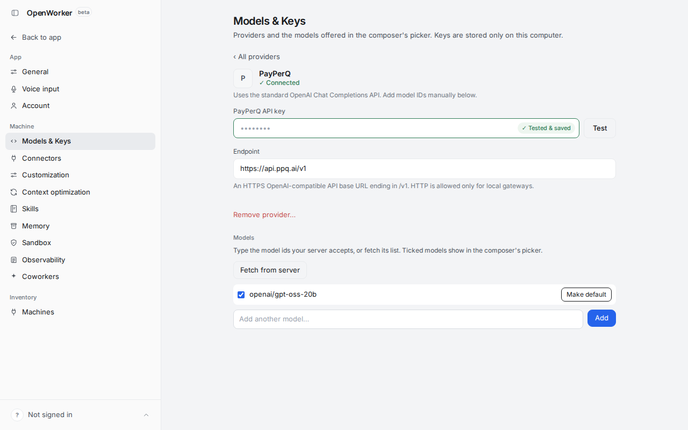
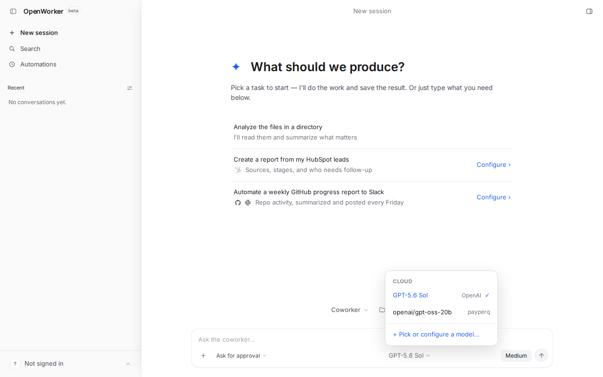
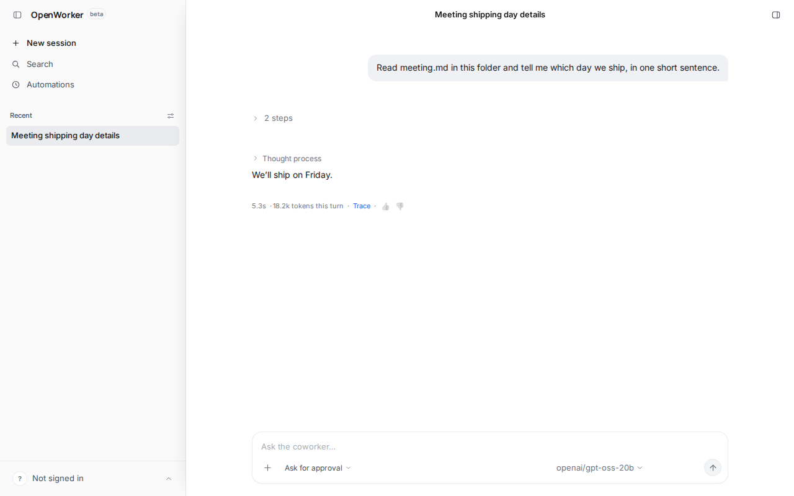

## What is OpenWorker?

OpenWorker is an open-source desktop app, built by Andrew Ng's team, that works as an AI coworker for everyday tasks: it reads files in a folder you choose, writes documents, reviews code and connects to tools such as GitHub and Slack. You decide which actions it may take, and it asks for approval where you set it to.

You bring your own model. OpenWorker runs locally, stores model keys in the app's local secret store, and lets you add any OpenAI-compatible endpoint under **Settings → Models & Keys**. That is how you connect PayPerQ. The project is on [GitHub](https://github.com/andrewyng/openworker) under the MIT license.

## Step by Step Set Up

### 1. Prerequisites

- A PayPerQ account and API key from [ppq.ai/api-docs](https://ppq.ai/api-docs).
- macOS 12 or newer on Apple Silicon, or Windows 10/11 (x64), the platforms the OpenWorker README lists for the desktop app.

### 2. Install the OpenWorker desktop app

Download the installer for your system from the OpenWorker README:

- macOS (Apple Silicon): [download.openworker.com/mac](https://download.openworker.com/mac)
- Windows 10/11 (x64): [download.openworker.com/windows](https://download.openworker.com/windows)

Install and open the app. The main window shows "What should we produce?" and a composer at the bottom with a **No model** warning. You do not need to sign in.

> **Note:** the app updates itself, and the README says the desktop app is in open beta, so screens may differ slightly from the images below.

### 3. Open Models & Keys

Click **No model** in the composer. Settings opens on **Models & Keys**. (You can also open Settings and choose **Models & Keys** in the left list.)

### 4. Add PayPerQ as an OpenAI-compatible provider

1. Scroll to the **API KEYS** group and click **Add an OpenAI-compatible provider**.
2. **Name:** type `PayPerQ`. The **Route prefix** fills in as `payperq`; leave it.
3. **Endpoint:** type `https://api.ppq.ai/v1`.
4. **API key:** paste `<your PayPerQ API key>`. The field is masked.
   
5. Click **Add provider**. The PayPerQ card opens with **✓ Connected** and **✓ Tested & saved** next to the key.
   

> **Note:** OpenWorker keeps the key on your computer, in its local secret store. You enter it once in this form; there is no environment variable or config file to edit.

### 5. Add a model

In the **Models** section of the PayPerQ card, type the model ID into **Add another model…** and click **Add**:

```
openai/gpt-oss-20b
```

The model appears in a list with its checkbox ticked; ticked models show in the composer's model picker.



> **Note:** `openai/gpt-oss-20b` costs $0.03165 per 1M input tokens and $0.13715 per 1M output tokens at the time of writing. See [api.ppq.ai/v1/models](https://api.ppq.ai/v1/models) for current prices.

> **Note:** this is an example. The full list of model IDs is the catalog at [api.ppq.ai/v1/models](https://api.ppq.ai/v1/models). OpenWorker takes the model ID as plain text, so copy the catalog's `id` field exactly. OpenWorker's docs say "Adding any model string works at your own risk" for models outside its curated list; for a tool-using session, choose a model whose `supported_parameters` includes `tools`.

### 6. Select the model and check it

Click **Back to app**. Click the model button in the composer (it may show another model, such as **GPT-5.6 Sol**). The picker lists `openai/gpt-oss-20b` with `payperq` on the right. Click it.



The composer's model button now reads `openai/gpt-oss-20b`.

### 7. Send a test prompt

OpenWorker works in a folder, shown next to **Coworker** above the composer. Pick a folder that contains a text or Markdown file (for example `meeting.md`). In the composer, type a short request that needs the file, and press Enter:

```
Read meeting.md in this folder and tell me which day we ship, in one short sentence.
```

The session shows a **Read meeting.md** step (under "2 steps") and an answer taken from the file, from a PayPerQ model.



> **Note:** adjust the file name and question to your own folder. If a prompt asks for approval, review it before continuing; the composer's **Ask for approval** setting controls this.

Setup is complete. OpenWorker now sends requests to PayPerQ. Check your spend at [ppq.ai/account-activity](https://ppq.ai/account-activity). To use another model, add its catalog ID in **Settings → Models & Keys → PayPerQ** and select it in the composer.

### Troubleshooting

**Windows shows a SmartScreen warning when you open the installer.** What happened: the OpenWorker README says the Windows builds are not yet code-signed. Likely cause: expected for the current builds. Fix: follow the steps Windows offers to run the app anyway, only if you downloaded it from the link in step 2.

## Problems?

Please contact us through the customer communication chatbot in the bottom right of the PayPerQ site, in our [Telegram channel](https://t.me/+ZjJDTazIrV0zNDFh) or on [Discord](https://discord.gg/BmMntEShYg).

This guide is open source. If a step no longer works, open [the guide on GitHub](https://github.com/PayPerQ/ppq-integration-guides/blob/main/guides/using-openworker-with-payperq.md) and use the pencil icon to propose a fix, or [open an issue](https://github.com/PayPerQ/ppq-integration-guides/issues); changes go live after a PayPerQ maintainer reviews them.
