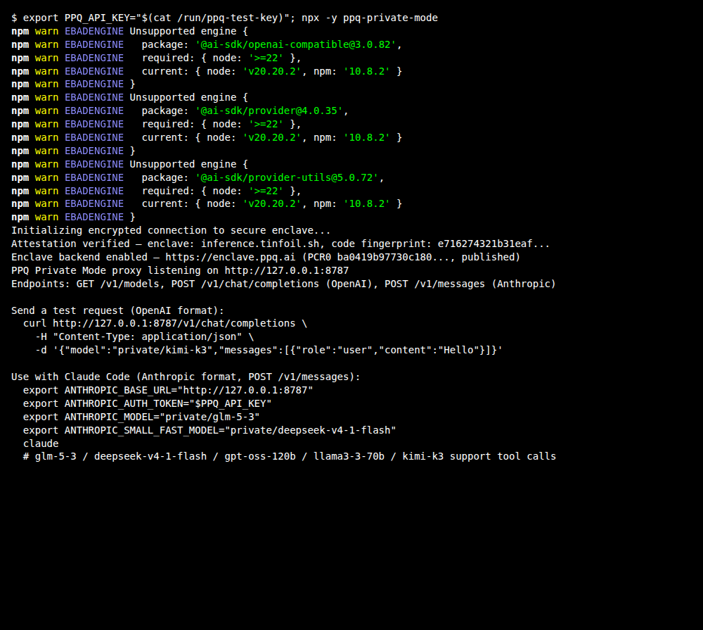
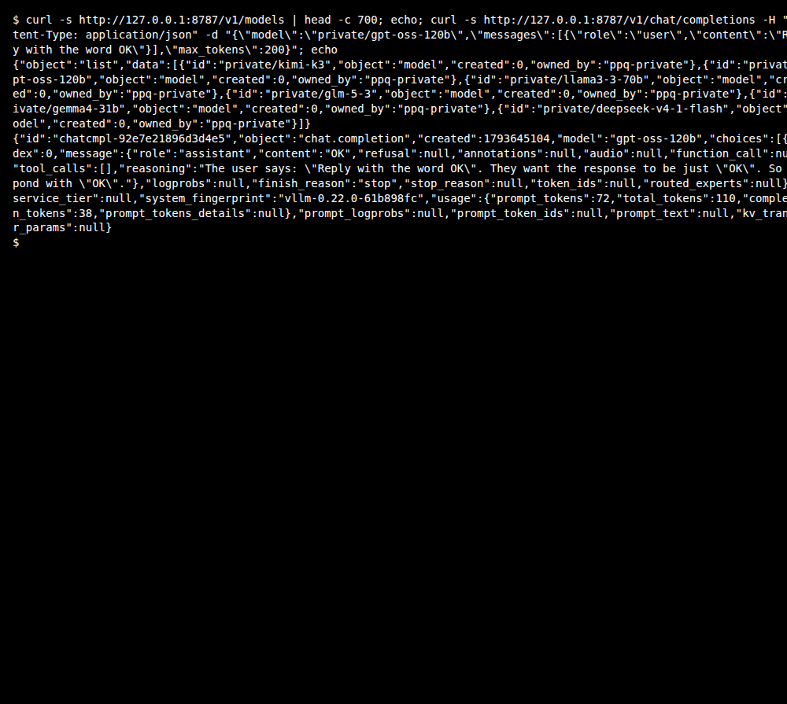

## What are "TEE" AI models?

TEE (Trusted Execution Environment) AI models run inside a hardware enclave: the server that runs the model cannot read the content of your queries. PPQ lists the `private/*` models with the privacy tier shown as `e2e` in the [model catalog](https://api.ppq.ai/v1/models); per the proxy's README, these are open-weight models such as Kimi and GLM served from inside a Tinfoil enclave, where the model itself runs.

## How to leverage these models using PPQ?

According to the [project's README](https://github.com/PayPerQ/ppq-private-mode-proxy), every PPQ chat request is now served inside an AWS Nitro enclave, with or without the proxy. The proxy is an optional add-on that lets *you* verify that: when it starts it checks the enclave's attestation and refuses to send anything if it does not match, then encrypts each request to the verified enclave on your machine and decrypts the response locally.

**Prerequisites:** a PayPerQ API key (from [ppq.ai/api-docs](https://ppq.ai/api-docs)) and Node.js 20 or newer.

## [→ github.com/PayPerQ/ppq-private-mode-proxy](https://github.com/PayPerQ/ppq-private-mode-proxy)

## Step by Step Set Up

Start the proxy in a terminal and leave it running. The key is read from the `PPQ_API_KEY` variable of the shell that starts it:

```bash
export PPQ_API_KEY="<your PayPerQ API key>"
npx ppq-private-mode
```

> **Windows:** in PowerShell, `$env:PPQ_API_KEY = "<your PayPerQ API key>"` sets the variable for the current window only. To keep it for new windows, run `setx PPQ_API_KEY "<your PayPerQ API key>"` and open a new terminal.

A successful start looks like this:



The proxy listens on `http://127.0.0.1:8787` and lists its models at `/v1/models`. Check that `private/gpt-oss-120b` is in the list, then send a short test request (any OpenAI- or Anthropic-compatible client can use the same address):

```bash
curl -s http://127.0.0.1:8787/v1/models
curl -s http://127.0.0.1:8787/v1/chat/completions -H "Content-Type: application/json" \
  -d '{"model":"private/gpt-oss-120b","messages":[{"role":"user","content":"Reply with the word OK"}],"max_tokens":200}'
```

> **Note:** `private/gpt-oss-120b` costs $0.158 per 1M input tokens and $0.633 per 1M output tokens at the time of writing. See [api.ppq.ai/v1/models](https://api.ppq.ai/v1/models) for current prices.

The reply's `content` is `OK`:



The proxy also ships an OpenClaw plugin. The repository's own OpenClaw skill installs it with `openclaw plugins install ppq-private-mode` and adds a provider entry pointing at `http://127.0.0.1:8787/v1` to `~/.openclaw/openclaw.json`; follow the proxy's README for the current steps.

> **Windows:** `~` is your user folder, so this file is `%USERPROFILE%\.openclaw\openclaw.json`.

## Using private models with Claude Code

The proxy also exposes a native Anthropic endpoint (`/v1/messages`), so you can point **Claude Code** at it. With the proxy running, set these in the shell that starts Claude Code, then launch it (the variables are the ones the proxy prints at startup):

```bash
export ANTHROPIC_BASE_URL="http://127.0.0.1:8787"
export ANTHROPIC_AUTH_TOKEN="<your PayPerQ API key>"
export ANTHROPIC_MODEL="private/glm-5-3"
export ANTHROPIC_SMALL_FAST_MODEL="private/deepseek-v4-1-flash"
claude
```

> **Windows:** in PowerShell, `$env:ANTHROPIC_BASE_URL = "http://127.0.0.1:8787"` sets the variable for the current window only. To keep it for new windows, run `setx ANTHROPIC_BASE_URL "http://127.0.0.1:8787"` and open a new terminal. Do the same for ANTHROPIC_AUTH_TOKEN = `"<your PayPerQ API key>"`, ANTHROPIC_MODEL = "private/glm-5-3" and ANTHROPIC_SMALL_FAST_MODEL = "private/deepseek-v4-1-flash".

See our [full Claude Code guide](https://ppq.ai/blog/using-claude-code-with-payperq) for VS Code extension setup and more.

## Available Private Models

This is the list the proxy returned from `/v1/models` at the time of writing; the full PPQ catalog is at [api.ppq.ai/v1/models](https://api.ppq.ai/v1/models) (its entries have a different format from the proxy's list: `id` is the model name, `pricing` holds the per-1M-token prices).

| Model | Best For |
|-------|----------|
| `private/kimi-k3-1-pro` | Moonshot's flagship for long-horizon coding and agentic work; reasoning on by default, 262K context |
| `private/gpt-oss-120b` | Budget-friendly general use |
| `private/llama3-3-70b` | Fast |
| `private/glm-5-3` | Agentic engineering, long-horizon tool use, 1M context |
| `private/gemma4-31b` | Vision-language with built-in thinking mode |
| `private/deepseek-v4-1-flash` | Multimodal refresh with vision input, 1M context |

### Troubleshooting

- **`EBADENGINE` warnings when running `npx ppq-private-mode`:** some of the proxy's dependencies (the `@ai-sdk/*` packages) ask for Node 22 or newer. On Node 20 the warnings are printed and the proxy still starts; upgrading Node removes them.

## What is PayPerQ?


PayPerQ is the private way to use AI. You get the big-name models from Anthropic, OpenAI, Google and xAI, the best open-source models, and TEE models that run inside a hardware enclave where not even the model's host can see your data. Chat, image, video and audio, all in one place, with no account and no subscription. You top up a balance with crypto or a card, from as little as 10 cents, and pay only for what you use. Most users spend about $4 a month, against $20+ for a single ChatGPT subscription.

Privacy is built in rather than bolted on. Every chat request is served inside a secure enclave that PayPerQ's servers, staff and logs cannot read into, so PayPerQ never sees your prompts or responses. Choose a TEE model and the model's host cannot read them either.

### Why Use PayPerQ?

- **Private by default** - chats are served inside a secure enclave PayPerQ cannot read, and every chat model shows its privacy tier (Anon, ZDR or TEE)
- **No account needed** - no sign-up and no email; a credit id is all it takes
- **Pay with crypto or card** - Bitcoin, Lightning, Monero, stablecoins and more, or a credit card
- **Hundreds of AI models** from every major provider in one place
- **Pay per use** - no subscriptions; top up from 10 cents and pay only for what you use, about 1 cent per query on average
- **Your history stays yours** - conversations are stored on your device by default

## Getting Started

1. Visit [ppq.ai](https://ppq.ai)
2. Top up your balance with crypto or a card (as little as 10 cents)
3. Pick a model, check its privacy tier, and start chatting

No account, no sign-up. Fund and go.

## Problems?

Please contact us through the customer communication chatbot in the bottom right of the PayPerQ site, in our [Telegram channel](https://t.me/+ZjJDTazIrV0zNDFh) or on [Discord](https://discord.gg/BmMntEShYg).

This guide is open source. If a step no longer works, open [the guide on GitHub](https://github.com/PayPerQ/ppq-integration-guides/blob/main/guides/using-private-tee-models-with-openclaw.md) and use the pencil icon to propose a fix, or [open an issue](https://github.com/PayPerQ/ppq-integration-guides/issues); changes go live after a PayPerQ maintainer reviews them.
