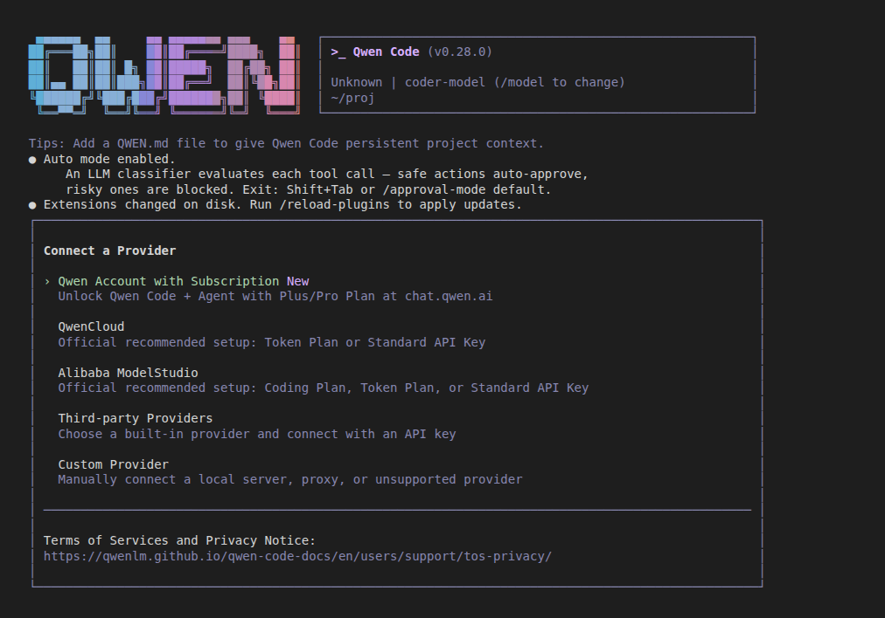
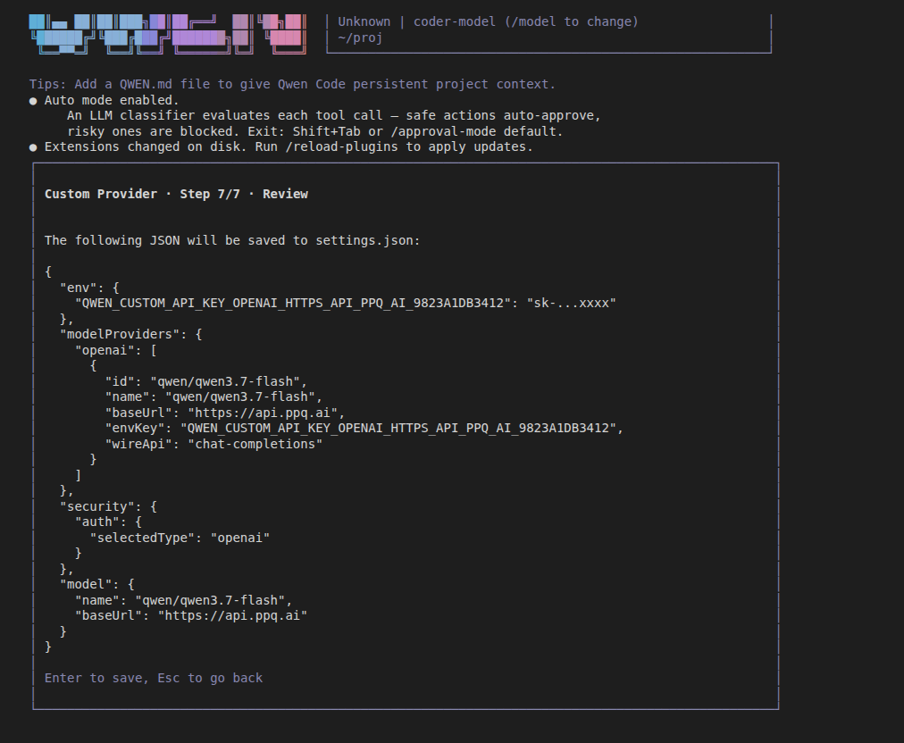
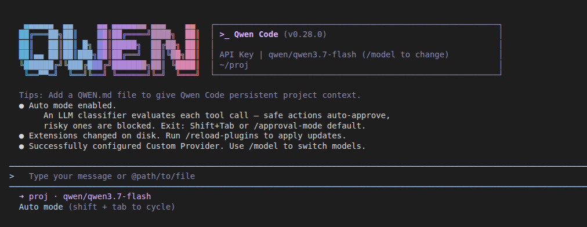
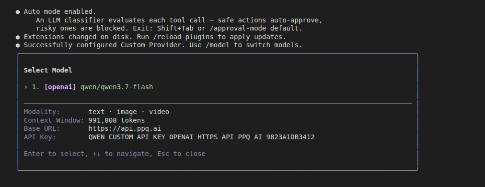
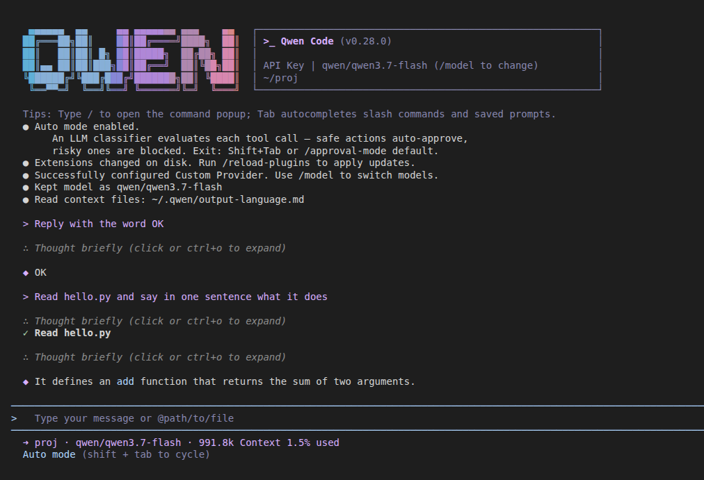

## What is Qwen Code?

Qwen Code is an open-source AI coding agent that runs in your terminal, made by the Qwen team (QwenLM). It reads and edits files in your project, runs commands and answers questions about your codebase, asking for approval before it changes things. Docs: [qwenlm.github.io/qwen-code-docs](https://qwenlm.github.io/qwen-code-docs/en/users/overview).

Qwen Code supports OpenAI-compatible endpoints through its Custom Provider option, which is how it connects to PayPerQ here: one API key, pay-per-use pricing, and a choice of models from many vendors.

## Step by Step Set Up

### 1. Prerequisites

- A PayPerQ account and API key. Sign in at [ppq.ai](https://ppq.ai) and copy the key from [ppq.ai/api-docs](https://ppq.ai/api-docs).
- Linux or macOS for the commands below; the Windows command is in a callout in step 2.
- A project folder to open Qwen Code in.

### 2. Install Qwen Code

**Run a command** in your terminal:

```bash
curl -fsSL https://qwen-code-assets.oss-cn-hangzhou.aliyuncs.com/installation/install-qwen-standalone.sh | bash
```

The installer downloads Qwen Code, adds `qwen` to your PATH and prints `Qwen Code ... installed successfully`.
> **Windows:** the Qwen Code docs give this PowerShell command instead: `irm https://qwen-code-assets.oss-cn-hangzhou.aliyuncs.com/installation/install-qwen-standalone.ps1 | iex`

> **Shell profile:** on macOS the default shell is zsh and the profile is `~/.zshrc`; on most Linux distributions it is bash and `~/.bashrc`; on Windows, PowerShell loads the file named by `$PROFILE`. Open a new terminal after editing it.

**Open a new terminal**, then **run a command** to check the install:

```bash
qwen --version
```

It prints a version number, for example `0.28.0`.

### 3. Add PayPerQ as a Custom Provider

**Run a command** in your project folder:

```bash
qwen
```

The "Connect a Provider" menu opens on first launch. **Choose a menu item:** use the arrow keys to select **Custom Provider** and press Enter.



Then **answer the seven prompts** of the Custom Provider wizard, in order:

1. **Protocol.** Select **OpenAI-compatible** and press Enter.
2. **API.** Select **Chat Completions** and press Enter.
3. **Base URL.** The field is prefilled with `https://api.openai.com/v1`. Clear it, type `https://api.ppq.ai` and press Enter.
4. **API Key.** Paste `<your PayPerQ API key>` and press Enter.
5. **Model IDs.** Type `qwen/qwen3.7-flash` and press Enter.
6. **Advanced generation settings.** Leave all options as they are and press Enter.
7. **Review.** Qwen Code shows the settings it will save. Check that the base URL is `https://api.ppq.ai` and the model is `qwen/qwen3.7-flash`, then press Enter.
   

Qwen Code shows `Successfully configured Custom Provider.` and the model `qwen/qwen3.7-flash` in the footer.



> **Note:** `qwen/qwen3.7-flash` costs $0.03165 per 1M input tokens and $0.13715 per 1M output tokens at the time of writing. See [api.ppq.ai/v1/models](https://api.ppq.ai/v1/models) for current prices. It is an example: the wizard's **Model IDs** field takes the `id` of any model in that catalog, and several IDs can be separated by commas.

> **Note:** the wizard saves the provider and the key in `~/.qwen/settings.json`. The Qwen Code docs list where an API key can come from, highest priority first: CLI flags, system environment variables (`export`), `.env` files, then the `env` field of `settings.json`.

> **Windows:** `~` is your user folder, so this file is `%USERPROFILE%\.qwen\settings.json`.

### 4. Check the provider and model

**Run a command** inside Qwen Code:

```text
/model
```

The list shows `1. [openai] qwen/qwen3.7-flash`, with `Base URL: https://api.ppq.ai`.



Press Esc to close the list.

### 5. Send a test prompt

Create a file `hello.py` in your project folder containing one line, `print("hello")`, then **type this prompt** in Qwen Code and press Enter:

```text
Read hello.py and say in one sentence what it does
```

Qwen Code shows `✓ Read hello.py` followed by a one-sentence answer based on the file's content.



The setup is complete. Check what your requests cost on [ppq.ai/account-activity](https://ppq.ai/account-activity). To use another model, run `/model` or repeat step 3 with another model ID from the catalog.

### Troubleshooting

**The model does not answer and Qwen Code reports an authentication error (401).** What happened: PayPerQ rejected the key. Likely cause: the key was pasted incompletely or from the wrong place, or the same variable is set from a higher-priority source (see the priority list in step 3). Fix: copy the key again from [ppq.ai/api-docs](https://ppq.ai/api-docs) and run `/auth` → **Custom Provider** to enter the settings again.

## Problems?

Please contact us through the customer communication chatbot in the bottom right of the PayPerQ site, in our [Telegram channel](https://t.me/+ZjJDTazIrV0zNDFh) or on [Discord](https://discord.gg/BmMntEShYg).

This guide is open source. If a step no longer works, open [the guide on GitHub](https://github.com/PayPerQ/ppq-integration-guides/blob/main/guides/using-qwen-code-with-payperq.md) and use the pencil icon to propose a fix, or [open an issue](https://github.com/PayPerQ/ppq-integration-guides/issues); changes go live after a PayPerQ maintainer reviews them.
