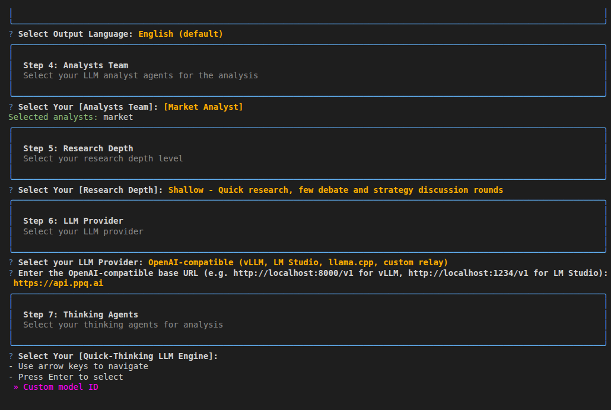
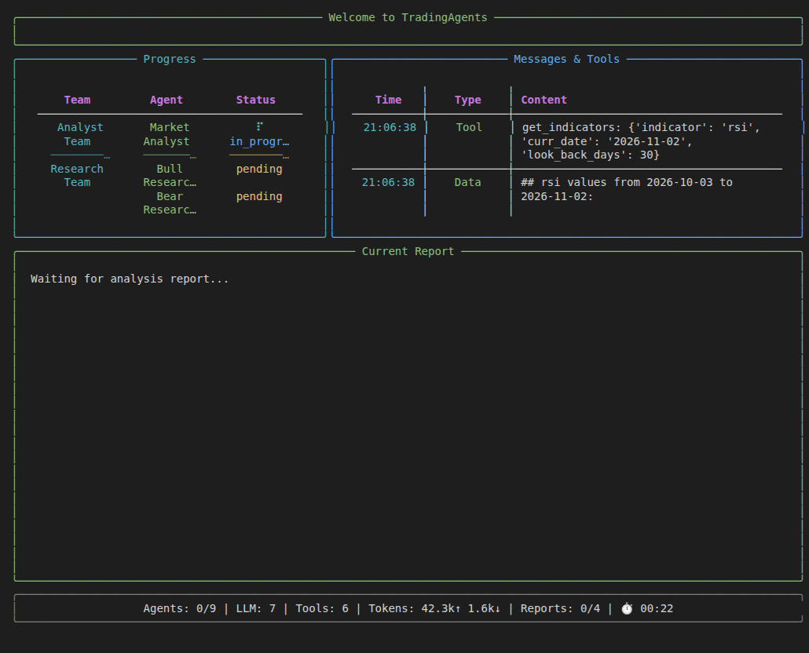
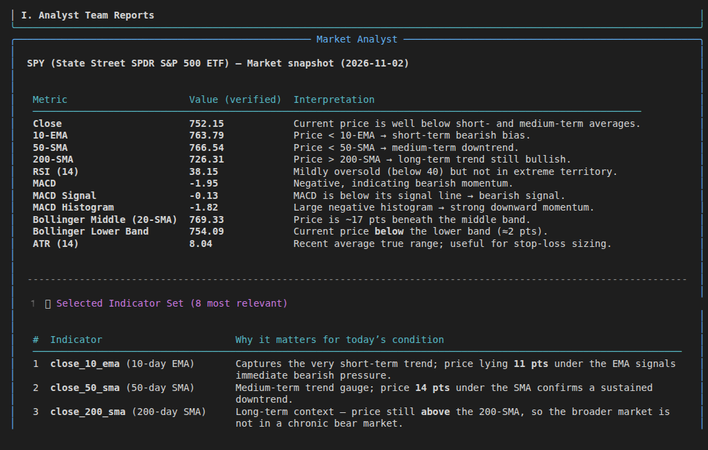

## What is TradingAgents?

TradingAgents is an open-source multi-agent framework for financial trading research from Tauric Research. A team of LLM agents (analysts, bull and bear researchers, a trader and risk managers) works through a ticker and produces reports and a trading decision.

It runs from an interactive command-line interface or as a Python package, and it supports many LLM providers, including any OpenAI-compatible endpoint, which is how you connect PayPerQ.

## Step by Step Set Up

### 1. Prerequisites

- A PayPerQ account and API key from [ppq.ai/api-docs](https://ppq.ai/api-docs).
- Python 3.11 or later (the TradingAgents docs: "TradingAgents needs Python 3.11 or later").
- Git, to clone the repository.

### 2. Install TradingAgents

1. **Run a command** to clone the repository:

```bash
git clone https://github.com/TauricResearch/TradingAgents.git
```

2. **Run a command** to enter the folder:

```bash
cd TradingAgents
```

3. **Run a command** to create a virtual environment:

```bash
python3 -m venv .venv
```

4. **Run a command** to activate it:

```bash
source .venv/bin/activate
```

5. **Run a command** to install the package and its dependencies:

```bash
pip install .
```

The install ends with `Successfully installed ... tradingagents-...`, and the `tradingagents` command is now available in this terminal.

> **Note:** the TradingAgents docs create the environment with conda or uv (`uv venv --python 3.13`) and say "any of your favorite environment managers" works. If you use uv, install with `uv pip install .`.

### 3. Store your PayPerQ key in `.env`

TradingAgents reads provider keys from a `.env` file. Keep running the commands from the `TradingAgents` folder.

1. **Run a command** to create `.env` from the template:

```bash
cp .env.example .env
```

2. **Edit the file** `.env` in the `TradingAgents` folder: find the line `#OPENAI_COMPATIBLE_API_KEY=`, remove the `#` and put your key after the `=`:

```
OPENAI_COMPATIBLE_API_KEY=<your PayPerQ API key>
```

Save the file. The TradingAgents docs say to "set `OPENAI_COMPATIBLE_API_KEY` when the endpoint requires one"; PayPerQ requires one.

### 4. Start TradingAgents and add PayPerQ as the provider

**Run a command** to start the interactive CLI:

```bash
tradingagents
```

The welcome banner appears, followed by a numbered series of prompts. Answer them in order:

1. **Step 1: Ticker Symbol.** Type `SPY` and press Enter (SPY is the default).
2. **Step 2: Analysis Date.** Press Enter to accept today's date.
3. **Step 3: Output Language.** Press Enter to keep English.
4. **Step 4: Analysts Team.** Press Space on **Market Analyst** so it shows a filled circle, then press Enter. One analyst keeps the first run short.
5. **Step 5: Research Depth.** Keep **Shallow** and press Enter.
6. **Step 6: LLM Provider.** Use the arrow keys to select **OpenAI-compatible (vLLM, LM Studio, llama.cpp, custom relay)**, the last item in the list, and press Enter.
7. **Enter the OpenAI-compatible base URL.** Type `https://api.ppq.ai` and press Enter.

You land on Step 7, the model picker.



> **Note:** the next time you start `tradingagents`, your previous answers come back as the defaults, so you can press Enter through steps 1 to 6.

### 5. Pick a model

Step 7 asks for two models. Both pickers show one entry, **Custom model ID**.

1. **Quick-Thinking LLM Engine.** Press Enter on **Custom model ID**, type `openai/gpt-oss-120b` and press Enter.
2. **Deep-Thinking LLM Engine.** Press Enter on **Custom model ID**, type `openai/gpt-oss-120b` and press Enter.

> **Note:** `openai/gpt-oss-120b` costs $0.02743 per 1M input tokens and $0.100225 per 1M output tokens at the time of writing. See [api.ppq.ai/v1/models](https://api.ppq.ai/v1/models) for current prices and the full model list; use a model ID from that catalog whose `supported_parameters` include `tools`, because the analysts call tools.

The analysis starts right after the second model ID.

### 6. Run the analysis and check the answer

The first analysis is the test: the screen switches to a progress panel and the Market Analyst fetches SPY data through its tools and sends it to the PayPerQ model.



> **Note:** the panel can stay on one agent for several minutes while the model answers. Wait for it.

When the run ends the CLI prints `Analysis Complete!` and asks:

1. **Save report?** Type `n` and press Enter.
2. **Display full report on screen?** Press Enter to accept the default.

The screen prints **I. Analyst Team Reports** with a **Market Analyst** section: a table of SPY indicators (Close, 10-EMA, 50-SMA, 200-SMA, RSI, MACD) with an interpretation for each, written by the PayPerQ model.



The setup is complete. Check what the run cost on [ppq.ai/account-activity](https://ppq.ai/account-activity). To use another model, start `tradingagents` again and enter a different model ID in step 7.

### Troubleshooting

**`OpenAIModelNotFoundError: Error code: 404 - No allowed providers are available for the selected model`** right after you enter the model IDs. What happened: PayPerQ could not route the request for the model you entered. Fix: start `tradingagents` again and enter `openai/gpt-oss-120b`, or another ID from [api.ppq.ai/v1/models](https://api.ppq.ai/v1/models).

## Problems?

Please contact us through the customer communication chatbot in the bottom right of the PayPerQ site, in our [Telegram channel](https://t.me/+ZjJDTazIrV0zNDFh) or on [Discord](https://discord.gg/BmMntEShYg).

This guide is open source. If a step no longer works, open [the guide on GitHub](https://github.com/PayPerQ/ppq-integration-guides/blob/main/guides/using-tradingagents-with-payperq.md) and use the pencil icon to propose a fix, or [open an issue](https://github.com/PayPerQ/ppq-integration-guides/issues); changes go live after a PayPerQ maintainer reviews them.
